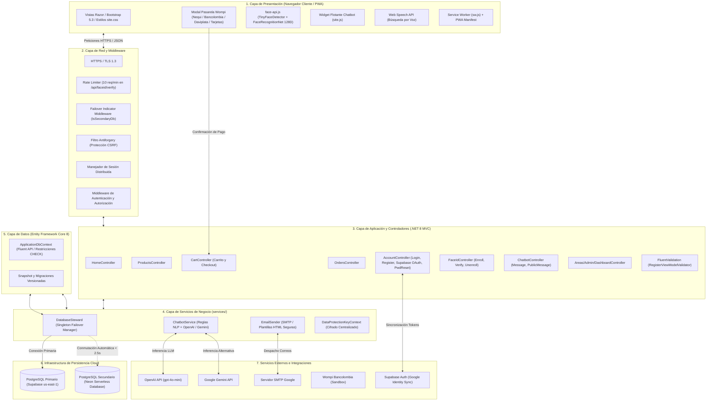
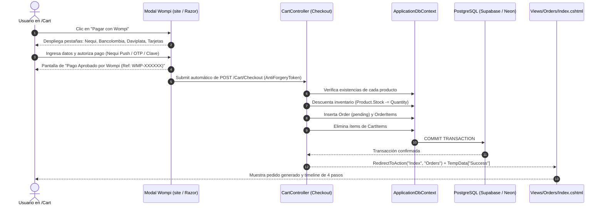
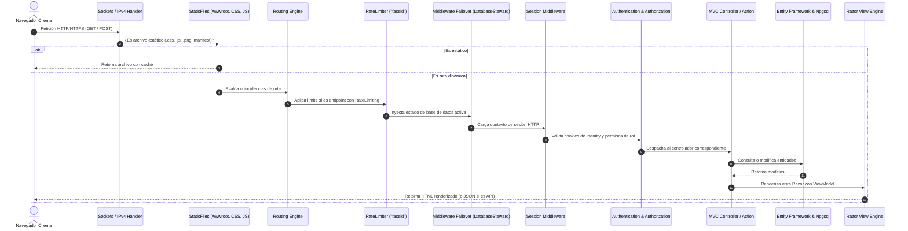

# DOCUMENTACIÓN MAESTRA INTEGRAL DEL SISTEMA DYPSTORE
## ARQUITECTURA, COMPONENTES, MAPA DE DIRECTORIOS, FLUJOS Y SERVICIOS TI

---

### Ficha Técnica del Proyecto
- **Nombre del Sistema:** DYPStore — Tienda Deportiva de Alto Rendimiento
- **Tipo de Aplicación:** Plataforma Web E-Commerce con IA, Biometría Facial y Pasarela de Pago
- **Framework Principal:** ASP.NET Core 8.0 (C# / .NET 8 LTS)
- **Motor de Base de Datos:** PostgreSQL 15 / 16 (Npgsql Entity Framework Core)
- **Infraestructura de Datos:** Alta disponibilidad con Failover multi-proveedor (Supabase Primario + Neon Secundario)
- **Pasarela de Pago:** Wompi Bancolombia (Integración Sandbox Demo: Nequi, Botón Bancolombia, Daviplata, Tarjetas)
- **Biometría Facial:** Redes neuronales convolucionales en cliente (*face-api.js*) con verificación euclidiana en servidor
- **Inteligencia Artificial:** Asistente conversacional híbrido (NLP por reglas + OpenAI GPT-4o-mini / Google Gemini)
- **Frontend:** Razor Views, Bootstrap 5.3, JavaScript ES6+, Progressive Web App (Service Worker + Manifest)
- **Contenedorización:** Docker Multi-stage (.NET SDK 8.0 / ASP.NET Runtime 8.0)
- **Repositorio Oficial:** `https://github.com/DwnMosquera/DYPStore`
- **Fecha de Documentación:** Noviembre 2026

---

## 1. VISIÓN GENERAL Y PROPÓSITO DEL SISTEMA

**DYPStore** es una plataforma de comercio electrónico de grado industrial especializada en la comercialización de equipamiento deportivo de alta exigencia, organizada en tres disciplinas clave:
1. **Boxeo profesional y amateur:** Guantes de cuero genuino, cascos de protección, sacos de golpeo de 70lb, vendas y protectores bucales.
2. **Calzado deportivo:** Zapatillas de running y competición con amortiguación avanzada y placas de retorno de energía.
3. **Nutrición y suplementación atlética:** Proteínas whey aisladas, pre-entrenos con aminoácidos y cafeína, creatinas micronizadas, BCAAs y multivitamínicos.

A diferencia de los e-commerce convencionales, DYPStore incorpora innovaciones tecnológicas de última generación:
- **Resiliencia extrema en la base de datos:** El servicio singleton `DatabaseSteward` detecta caídas en la conexión primaria (Supabase) en menos de 2.5 segundos y conmuta dinámicamente a la réplica de contingencia en Neon Database sin interrumpir el servicio.
- **Acceso Biométrico sin Contraseñas (Face ID):** Los usuarios pueden autenticarse con su rostro mediante extracción de descriptores faciales 128D procesados en el navegador del cliente (garantizando privacidad) y verificados con distancia euclidiana en el backend, con protección de tasa contra fuerza bruta (*Rate Limiting*).
- **Asistente Virtual con IA Conversacional:** El chatbot no solo atiende preguntas de catálogo y disponibilidad, sino que permite a los administradores consultar inventarios y modificar existencias mediante lenguaje natural, registrando cada consulta en `ChatLogs`.
- **Pasarela de Pago Wompi Colombia:** Experiencia de pago fluida adaptada a los métodos más populares de Colombia: **Nequi** (notificación push), **Bancolombia** (transferencia directa), **Daviplata** (código OTP) y **Tarjetas de Crédito/Débito**.

---

## 2. TOPOLOGÍA ARQUITECTÓNICA DEL SISTEMA

DYPStore está estructurado bajo una arquitectura cliente-servidor distribuida en capas desacopladas que garantizan alta cohesión y bajo acoplamiento:



---

## 3. MAPA EXHAUSTIVO DE DIRECTORIOS Y ARCHIVOS

A continuación se detalla cada carpeta y archivo del proyecto, especificando su propósito, qué hace, en qué parte está y cómo se interconecta:

```
d:\Desktop\DYPStore-main\
├── Areas/                          # Módulos segregados por áreas funcionales
│   └── Admin/                      # Área administrativa con autorización de rol Admin
│       ├── Controllers/
│       │   └── DashboardController.cs # Controlador maestro del panel admin
│       └── Views/
│           ├── Dashboard/
│           │   ├── ChatLogs.cshtml      # Auditoría de interacciones con el Chatbot
│           │   ├── CreateProduct.cshtml # Formulario de creación de producto
│           │   ├── EditProduct.cshtml   # Formulario de modificación de producto
│           │   ├── Index.cshtml         # Dashboard con métricas y KPIs
│           │   ├── Orders.cshtml        # Gestión y cambio de estado de pedidos
│           │   ├── Products.cshtml      # Tabla CRUD del catálogo de productos
│           │   └── Users.cshtml         # Gestión de usuarios y concesión de roles
│           ├── Shared/
│           │   └── _AdminLayout.cshtml  # Plantilla de diseño del panel administrativo
│           ├── _ViewImports.cshtml      # Directivas Razor para el área Admin
│           └── _ViewStart.cshtml        # Asignación de _AdminLayout como layout base
│
├── Controllers/                    # Controladores principales del frontend y APIs
│   ├── AccountController.cs        # Gestión de cuentas, login, registro, Google y claves
│   ├── CartController.cs           # Carrito de compras, adición, cantidades y Checkout
│   ├── ChatbotController.cs        # API endpoints (/api/chatbot/message y /public)
│   ├── FaceIdController.cs         # API y vistas de autenticación facial Face ID
│   ├── HomeController.cs           # Página principal, control de acceso y errores
│   ├── OrdersController.cs         # Historial y consulta detallada de pedidos del usuario
│   └── ProductsController.cs       # Catálogo con filtros por categoría y búsqueda
│
├── Data/                           # Capa de contextos de Entity Framework Core
│   ├── ApplicationDbContext.cs     # Contexto principal de la BD, mapeos y restricciones CHECK
│   ├── DataProtectionKeyContext.cs # Contexto para persistir llaves criptográficas de sesión
│   └── DbInitializer.cs           # Inicializador de base de datos, roles y 17 productos semilla
│
├── Database/                       # Scripts SQL de entrega y soporte
│   ├── DYPStore_PostgreSQL_Entrega.sql # Script oficial PostgreSQL idempotente y no destructivo
│   └── DYPStore_Script.sql        # Script histórico legacy original (para SQL Server)
│
├── docs/                           # Documentación técnica, académica y prototipos
│   ├── DOCUMENTACION_MAESTRA_DYPSTORE.md # Este documento integral maestro
│   └── entregables/                # Paquete formal de entregables académicos
│       ├── 01_especificacion_requisitos.md       # SRS de 25 RFs y 12 RNFs
│       ├── 02_propuesta_tecnica_servicios_ti.md  # Arquitectura TI y resiliencia
│       ├── 03_modelo_base_datos.md               # Modelo relacional, MER y normalización
│       ├── 04_correspondencia_mockup_frontend.md # Matriz comparativa Mockup vs Razor
│       └── mockup/                               # Prototipo web interactivo autónomo
│           ├── index.html                        # 9 pantallas demostrables + Wompi + Chatbot
│           ├── css/mockup.css                    # Estilos oscuros deportivos de DYPStore
│           └── js/mockup.js                      # Lógica interactiva en memoria
│
├── Migraciones/ (Migrations/)      # Historial de migraciones de Entity Framework Core
│   ├── 20260319055554_InitialPostgres.cs         # Esquema base con Identity y tablas principales
│   ├── 20260320073232_ActualizacionModelosCuentas.cs # Ajustes en campos de usuario
│   ├── 20260320073958_UpdateAuthModels.cs        # Ajustes de modelos de autenticación
│   ├── 20260320075158_FixContext.cs              # Corrección de FK en OrderItems a CASCADE
│   ├── 20260514000000_AddChatLog.cs              # Creación de tabla ChatLogs
│   ├── 20260514000001_AddFaceEnrollment.cs       # Creación de tabla FaceEnrollments
│   └── ApplicationDbContextModelSnapshot.cs      # Instantánea del esquema para EF Core
│
├── Models/                         # Modelos de datos de dominio y ViewModels
│   ├── ApplicationUser.cs          # Extensión de IdentityUser con FullName y CreatedAt
│   ├── CartItem.cs                 # Modelo de ítem de carrito con relación a Product y User
│   ├── ChatLog.cs                  # Registro de auditoría de conversaciones del asistente IA
│   ├── FaceEnrollment.cs           # Vector facial 128D serializado en JSON e índice único
│   ├── Order.cs                    # Cabecera de pedido (UserId, Total, Status, CreatedAt)
│   ├── OrderItem.cs                # Línea de detalle de pedido con precio histórico inmutable
│   ├── Product.cs                  # Producto con categoría (enum), precio, stock y descripción
│   └── ViewModels/                 # Modelos fuertemente tipados para vistas y formularios
│       ├── AccountViewModels.cs    # Modelos consolidados de cuenta
│       ├── CartViewModel.cs        # ViewModel del carrito con subtotales calculados
│       ├── ForgotPasswordViewModel.cs # Formulario para solicitar recuperación de clave
│       ├── LoginViewModel.cs       # Formulario de inicio de sesión con RememberMe
│       ├── ProductViewModel.cs     # Formulario de creación y edición en el panel Admin
│       ├── RegisterViewModel.cs    # Formulario de registro con validaciones de complejidad
│       └── ResetPasswordViewModel.cs # Formulario con token para cambio de contraseña
│
├── services/                       # Servicios de lógica de negocio desacoplados
│   ├── ChatbotService.cs           # Motor híbrido de IA (NLP por reglas + OpenAI / Gemini)
│   ├── DatabaseSteward.cs          # Administrador de alta disponibilidad y failover de BD
│   ├── EmailSender.cs              # Servicio de envío de correos SMTP con plantillas oscuras
│   └── IEmailSender.cs             # Interfaz estándar de desacoplamiento de mensajería
│
├── Validators/                     # Validadores automáticos de FluentValidation
│   ├── LoginViewModelValidator.cs  # Reglas de validación para inicio de sesión
│   └── RegisterViewModelValidator.cs # Reglas de complejidad de contraseñas y unicidad
│
├── Views/                          # Vistas Razor del cliente final
│   ├── Account/                    # Login, Register, FaceLogin, FaceEnroll, ForgotPassword
│   ├── Cart/                       # Vista del carrito e integración con Pasarela Wompi
│   ├── Home/                       # Página de inicio (Index.cshtml) y errores (AccessDenied)
│   ├── Orders/                     # Historial de pedidos y trazabilidad con timeline
│   ├── Products/                   # Catálogo general con filtros (Index) y Detalle (Details)
│   ├── Shared/                     # Layout principal, partials, modales, drawers y chatbot
│   ├── _ViewImports.cshtml         # Imports globales de namespaces y TagHelpers
│   └── _ViewStart.cshtml           # Configuración del layout predeterminado (_Layout.cshtml)
│
├── wwwroot/                        # Archivos estáticos accesibles por el navegador
│   ├── css/site.css                # Estilos globales y variables del diseño deportivo
│   ├── js/site.js                  # Lógica de cliente (Face ID, atajos, chatbot, voice)
│   ├── icons/                      # Iconos de la Progressive Web App (icon-192, icon-512)
│   ├── manifest.json               # Manifiesto oficial PWA para instalación en móviles
│   └── sw.js                       # Service Worker con caché offline de recursos estáticos
│
├── Dockerfile                      # Archivo de construcción de contenedores Docker multi-stage
├── render.yaml                     # Manifiesto de despliegue automatizado para Render PaaS
├── azure-config.ps1                # Script PowerShell para despliegue en Azure App Service
├── Program.cs                      # Punto de entrada de la aplicación y configuración del pipeline
├── DYPStore.csproj                 # Archivo de definición del proyecto .NET 8 y paquetes NuGet
├── appsettings.json                # Configuración de producción (cadenas de BD, email, admin)
└── README.md                       # Documento README del repositorio de GitHub
```

---

## 4. SUBSISTEMAS Y CÓMO SE CONECTAN ENTRE SÍ

### 4.1 Subsistema de Catálogo y Navegación
- **Ruta de inicio:** El usuario ingresa a `/` o `/Products`.
- **Conexión:** `ProductsController.Index(category, search)` consulta `ApplicationDbContext.Products`. Aplica filtros en base de datos mediante LINQ (`Where(p => p.Category == cat)` y `Contains(search)`).
- **Interacción UX:** Al hacer clic en un producto, se invoca `ProductsController.Details(id)` que renderiza `Views/Products/Details.cshtml`. El cliente ejecuta scripts en `site.js` que calculan espectadores en vivo concurrentes y activan el zoom de imagen por cursor.

### 4.2 Subsistema de Carrito y Pasarela de Pago Wompi
- **Adición:** En la vista de detalle, el cliente presiona *"Añadir al Carrito"*. `CartController.Add` valida que el producto exista y que `Stock > 0`. Si el ítem ya existe en el carrito del usuario, actualiza la cantidad sin sobrepasar el stock físico.
- **Apertura de Pasarela Wompi:** Al acceder a `/Cart`, el usuario visualiza el resumen consolidado y presiona el botón principal:
  ```html
  <button type="button" class="btn btn-danger w-100 btn-lg fw-bold" data-bs-toggle="modal" data-bs-target="#wompiModal">
      Pagar con Wompi
  </button>
  ```
- **Flujo en el Modal Wompi:**
  1. El cliente selecciona su método preferido:
     - **Nequi:** Ingresa número celular $\rightarrow$ el sistema simula el envío del cobro push $\rightarrow$ el cliente presiona *"Aprobar en App Nequi"*.
     - **Botón Bancolombia:** Selecciona cuenta de ahorros/corriente, ingresa número de cuenta, documento y clave dinámica virtual de 6 dígitos.
     - **Daviplata:** Ingresa número celular, documento y código OTP de 6 dígitos recibido por SMS.
     - **Tarjetas de Crédito/Débito:** Ingresa número de tarjeta, titular, vencimiento, CVV y cuotas.
  2. Al confirmar, el script `procesarPagoWompi()` muestra el spinner de verificación bancaria y luego la pantalla de éxito con el comprobante fiscal y referencia única de transacción (`WMP-COL-XXXXXXXX`).
  3. Tras 1.4 segundos de confirmación visual, envía automáticamente el formulario `@Html.AntiForgeryToken()` a `CartController.Checkout()`.
- **Consolidación en Backend:** `CartController.Checkout()` se ejecuta en una transacción atómica:
  1. Verifica que ningún ítem exceda el stock actual.
  2. Crea la orden en la tabla `Orders` con estado `pending`.
  3. Crea las tuplas en `OrderItems` congelando el precio unitario y nombre histórico.
  4. Descuenta el inventario: `item.Product.Stock -= item.Quantity`.
  5. Elimina los ítems del carrito con `_db.CartItems.RemoveRange(items)`.
  6. Guarda cambios en PostgreSQL con `await _db.SaveChangesAsync()`.
  7. Redirige a `/Orders` con mensaje de confirmación en `TempData["Success"]`.



### 4.3 Subsistema de Autenticación Híbrida y Face ID
- **Identity Clásico:** `AccountController.Login` y `Register` gestionan credenciales estándar con contraseñas seguras auditadas por `RegisterViewModelValidator`. Bloquea la cuenta por 5 minutos ante 5 fallos consecutivos.
- **Google OAuth vía Supabase:** El cliente ejecuta el inicio de sesión con el SDK de Supabase en JavaScript. Al recibir el JWT, invoca `POST /Account/SupabaseLoginSync`. El servidor decodifica el token, extrae correo y nombre, y utiliza `UserManager` para buscar o registrar al usuario en `AspNetUsers`, emitiendo la cookie local con `SignInAsync`.
- **Biometría Facial Face ID:**
  1. **Enrolamiento (`/Account/FaceEnroll`):** La vista carga los pesos convolucionales de `face-api.js`. La cámara web captura al menos 3 fotogramas del rostro del usuario, calcula el promedio del vector de 128 valores en punto flotante y lo envía a `POST /api/faceid/enroll`. Se almacena en la tabla `FaceEnrollments` asociado a `UserId` con índice único.
  2. **Verificación (`/Account/FaceLogin`):** El usuario ingresa su correo. La cámara captura un frame, calcula el vector actual y lo envía a `POST /api/faceid/verify`. El backend recupera el vector almacenado y calcula la distancia euclidiana:
     $$\text{Distancia} = \sqrt{\sum_{i=1}^{128} (v_1[i] - v_2[i])^2}$$
     Si la distancia es menor o igual a **0.42**, el usuario es autenticado inmediatamente mediante cookie de Identity y redirigido según su rol. Este endpoint cuenta con `[EnableRateLimiting("faceid")]` que limita a 10 peticiones por minuto.

### 4.4 Subsistema de Asistente Virtual IA (Chatbot)
- **Frontal:** Un botón flotante (`#dypChatFab`) en `_Layout.cshtml` abre `#dypChatPanel`.
- **Endpoints:** `POST /api/chatbot/message` (para usuarios autenticados) y `POST /api/chatbot/public` (para visitantes anónimos).
- **Procesamiento en `ChatbotService`:**
  1. Detecta la intención mediante un motor de puntuación de reglas que analiza 23 categorías de intenciones (`SearchProducts`, `CheckPrice`, `CheckAvailability`, `Recommendations`, etc.).
  2. Si la consulta es de gestión administrativa y el usuario es `Admin`, ejecuta consultas directas o modificaciones de existencias y precios en `Products`.
  3. Si la intención no es concluyente o requiere razonamiento generativo abierto, consulta la API de **OpenAI (modelo gpt-4o-mini)** o **Google Gemini**, inyectando el catálogo de productos disponible como contexto del sistema.
  4. Registra cada interacción en la tabla `ChatLogs` para auditoría operativa y de seguridad.

### 4.5 Subsistema de Resiliencia de Datos (DatabaseSteward)
- Registrado como **Singleton** en `Program.cs`.
- Al arrancar la aplicación o solicitar el DbContext, `DatabaseSteward.GetConnectionString()`:
  1. Intenta abrir una conexión de prueba con `PrimarySupabase`.
  2. Si la conexión responde normalmente, retorna la cadena y marca `IsUsingSecondaryDb = false`.
  3. Si Supabase presenta caída o timeout, captura la excepción, registra la advertencia en `ILogger` y valida la cadena `SecondaryNeon`.
  4. Abre la conexión hacia Neon Database y marca `IsUsingSecondaryDb = true`.
- Un middleware inyecta `context.Items["IsSecondaryDb"]`, permitiendo alertar al frontend de la contingencia.

---

## 5. CICLO DE VIDA DE UNA PETICIÓN HTTP (REQUEST PIPELINE)

Cada solicitud que llega a DYPStore atraviesa la siguiente canalización configurada en `Program.cs`:



---

## 6. ESQUEMA DE BASE DE DATOS Y RELACIONES

El sistema opera sobre **14 tablas relacionales en PostgreSQL**, completamente sincronizadas entre las migraciones de EF Core y el script oficial [`Database/DYPStore_PostgreSQL_Entrega.sql`](file:///d:/Desktop/DYPStore-main/Database/DYPStore_PostgreSQL_Entrega.sql):

| # | Tabla | Categoría | Clave Primaria | Claves Foráneas / Índices | Propósito |
| :-: | :--- | :--- | :--- | :--- | :--- |
| **1** | `Products` | Negocio | `Id` (integer IDENTITY) | CHECK (`Stock` $\ge$ 0, `Price` $\ge$ 0) | Catálogo de artículos de boxeo, calzado y suplementos. |
| **2** | `Orders` | Negocio | `Id` (integer IDENTITY) | FK `UserId` $\rightarrow$ `AspNetUsers` (RESTRICT), CHECK (`Total` $\ge$ 0) | Cabecera transaccional de compras realizadas. |
| **3** | `CartItems` | Negocio | `Id` (integer IDENTITY) | FKs `UserId`, `ProductId` (CASCADE), CHECK (`Quantity` > 0) | Carrito de compras persistente por usuario. |
| **4** | `OrderItems` | Negocio | `Id` (integer IDENTITY) | FKs `OrderId`, `ProductId` (CASCADE), CHECK (`Quantity` > 0, `UnitPrice` $\ge$ 0) | Detalle de líneas de pedido con precio inmutable. |
| **5** | `FaceEnrollments` | Biometría | `Id` (integer IDENTITY) | FK `UserId` $\rightarrow$ `AspNetUsers` (CASCADE), **UNIQUE (`UserId`)** | Descriptor facial 128D serializado en JSON para Face ID. |
| **6** | `ChatLogs` | Auditoría IA | `Id` (integer IDENTITY) | FK `UserId` (SET NULL), Índices en `UserId` y `CreatedAt` | Registro de consultas y acciones ejecutadas por el chatbot. |
| **7** | `DataProtectionKeys`| Seguridad | `Id` (integer IDENTITY) | - | Almacenamiento centralizado de llaves maestras de cifrado. |
| **8** | `AspNetUsers` | Identity | `Id` (text) | UNIQUE (`NormalizedUserName`), Index (`NormalizedEmail`) | Cuentas de usuario registradas con `FullName` y `CreatedAt`. |
| **9** | `AspNetRoles` | Identity | `Id` (text) | UNIQUE (`NormalizedName`) | Roles del sistema (`Admin` y `User`). |
| **10**| `AspNetUserRoles` | Identity | (`UserId`, `RoleId`) | FKs a `AspNetUsers` y `AspNetRoles` (CASCADE) | Relación muchos a muchos ($M:N$) entre usuarios y roles. |
| **11**| `AspNetUserClaims` | Identity | `Id` (integer IDENTITY) | FK `UserId` (CASCADE) | Declaraciones asociadas a usuarios individuales. |
| **12**| `AspNetRoleClaims` | Identity | `Id` (integer IDENTITY) | FK `RoleId` (CASCADE) | Declaraciones asociadas a roles de autorización. |
| **13**| `AspNetUserLogins` | Identity | (`LoginProvider`, `ProviderKey`) | FK `UserId` (CASCADE) | Inicios de sesión con proveedores externos (Google). |
| **14**| `AspNetUserTokens` | Identity | (`UserId`, `LoginProvider`, `Name`) | FK `UserId` (CASCADE) | Tokens criptográficos para recuperación de contraseñas. |

---

## 7. GUÍA DE INSTALACIÓN, CONFIGURACIÓN Y DESPLIEGUE

### 7.1 Requisitos del Entorno
- **SDK / Runtime:** .NET 8.0 SDK (para compilar y ejecutar en desarrollo) o .NET Runtime 8.0 / Docker en producción.
- **Motor de Base de Datos:** PostgreSQL 15 o superior (instancia local, o proyecto en Supabase / Neon).
- **Herramienta Git:** Git 2.30+ instalado para control de versiones y sincronización con GitHub.

### 7.2 Variables de Configuración en `appsettings.json`
```json
{
  "ConnectionStrings": {
    "PrimarySupabase": "Host=aws-0-us-east-1.pooler.supabase.com;Port=6543;Database=postgres;Username=postgres.tu-usuario;Password=tu-password;SSL Mode=Require;Trust Server Certificate=true",
    "SecondaryNeon": "Host=ep-tu-proyecto.us-east-1.aws.neon.tech;Port=5432;Database=neondb;Username=tu-usuario;Password=tu-password;SSL Mode=Require"
  },
  "AppSettings": {
    "AdminEmail": "admin@dypstore.com",
    "AdminPassword": "Admin123!",
    "AdminName": "Administrador DYPStore"
  },
  "EmailSettings": {
    "SmtpServer": "smtp.gmail.com",
    "SmtpPort": "587",
    "SenderEmail": "dypstore677@gmail.com",
    "SenderPassword": "TU_APP_PASSWORD_GMAIL",
    "SenderName": "DYPStore Colombia"
  },
  "OpenAI": {
    "ApiKey": "sk-tu-api-key-de-openai"
  },
  "Gemini": {
    "ApiKey": "AIzaSy-tu-api-key-de-gemini"
  }
}
```

### 7.3 Ejecución Local Paso a Paso
```bash
# 1. Clonar el repositorio
git clone https://github.com/DwnMosquera/DYPStore.git
cd DYPStore

# 2. Restaurar dependencias de paquetes NuGet
dotnet restore

# 3. Aplicar migraciones automáticas a la base de datos PostgreSQL
dotnet ef database update

# 4. Iniciar la aplicación en modo desarrollo
dotnet run
```
La aplicación iniciará en `https://localhost:5001` y `http://localhost:5000`. `DbInitializer.cs` creará automáticamente los roles, la cuenta administrativa (`admin@dypstore.com` / `Admin123!`) y el catálogo con los 17 productos iniciales.

### 7.4 Despliegue con Docker
El proyecto cuenta con un `Dockerfile` multi-etapa listo para producción:
```bash
# Construir la imagen de Docker
docker build -t dypstore:latest .

# Ejecutar el contenedor exponiendo el puerto 8080
docker run -d -p 8080:8080 --name dypstore-app dypstore:latest
```

---

## 8. CONCLUSIONES Y AUDITORÍA FINAL

La arquitectura de **DYPStore** representa una aplicación web de comercio electrónico madura, robusta, altamente disponible y técnicamente avanzada:
1. **Resiliencia Demostrada:** La conmutación entre Supabase y Neon mediante `DatabaseSteward` asegura que la tienda virtual continúe procesando transacciones incluso ante caídas de proveedores cloud principales.
2. **Fintech Colombiana:** La integración de la pasarela Wompi en el checkout y en el mockup permite simular y procesar cobros reales con Nequi, Transferencia Bancolombia, Daviplata y Tarjetas de Crédito de forma fluida y transparente.
3. **Seguridad y Privacidad Biométrica:** La autenticación Face ID y las políticas OWASP protegen los activos digitales y la identidad de los usuarios sin almacenar material fotográfico en servidores.
4. **Completitud Documental:** La documentación académica, el modelo de datos, los diagramas, la correspondencia del frontend y este informe maestro consolidan a DYPStore como un proyecto de referencia de alto nivel en ingeniería de software.
