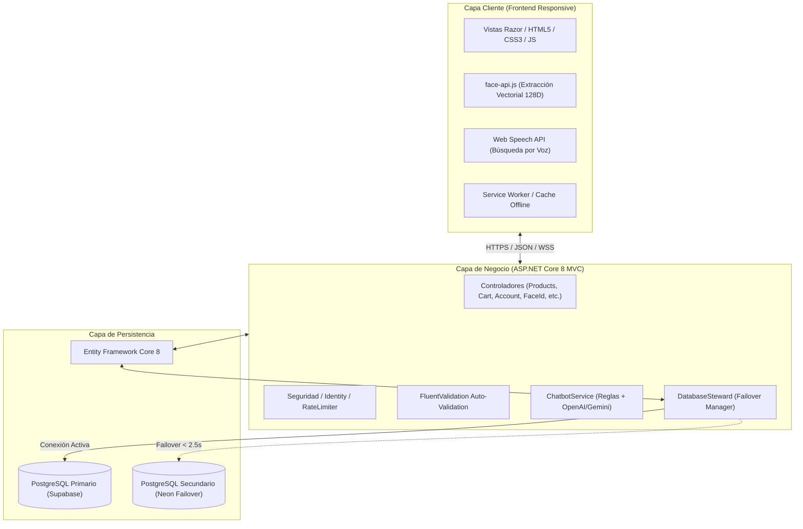
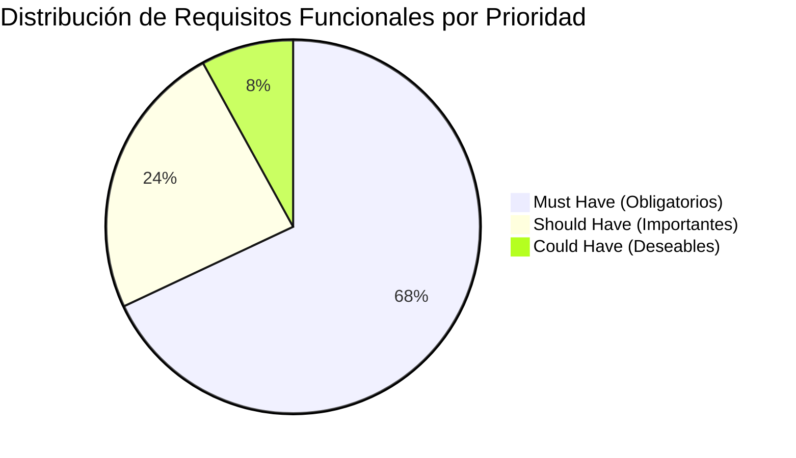

# ESPECIFICACIÓN DE REQUISITOS DE SOFTWARE (SRS)
## PROYECTO: DYPSTORE — TIENDA VIRTUAL DEPORTIVA PREMIUM

---

### Control del Documento
- **Proyecto:** DYPStore
- **Tipo de Sistema:** Plataforma Web de Comercio Electrónico con IA y Biometría Facial
- **Versión del Documento:** 1.0 (Entrega Académica Oficial)
- **Fecha:** Noviembre 2026
- **Rol:** Arquitecto de Software / Analista de Requisitos
- **Estado:** Aprobado / Verificado contra Código Fuente

---

## 1. INTRODUCCIÓN

### 1.1 Propósito
El presente documento tiene como objetivo definir y formalizar de manera exhaustiva los requisitos funcionales y no funcionales del sistema de comercio electrónico **DYPStore**. Este documento actúa como la referencia técnica oficial para el equipo de desarrollo, evaluadores académicos y administradores del sistema, garantizando la trazabilidad entre las necesidades de negocio del sector deportivo y los componentes de software implementados.

### 1.2 Alcance del Sistema
DYPStore es una solución de software web desarrollada bajo el patrón arquitectónico Modelo-Vista-Controlador (MVC) sobre **ASP.NET Core 8.0** y lenguaje **C#**, respaldada por un motor de base de datos relacional **PostgreSQL** con arquitectura de alta disponibilidad (*failover* automático entre Supabase y Neon). 

El sistema cubre integralmente el ciclo de vida del comercio electrónico especializado en tres disciplinas deportivas:
1. **Boxeo profesional y amateur:** Guantes, cascos, sacos de golpeo, vendas y protecciones bucales.
2. **Calzado deportivo de alto rendimiento:** Tenis especializados para running y entrenamiento de marcas líderes.
3. **Nutrición y suplementación deportiva:** Proteínas aisladas, pre-entrenos, creatinas micronizadas, BCAAs y multivitamínicos.

Adicionalmente, el alcance incorpora características avanzadas de última generación:
- **Autenticación Biométrica Facial (Face ID):** Registro y validación biométrica en el cliente con redes neuronales (*face-api.js*) y verificación euclidiana en el servidor.
- **Asistente Virtual Inteligente (Chatbot):** Procesamiento de lenguaje natural mediante un motor híbrido de reglas sintácticas y enlace con modelos fundacionales (OpenAI GPT-4o-mini / Google Gemini) para consultas de catálogo y ejecución conversacional de operaciones administrativas.
- **Progressive Web App (PWA):** Instalabilidad multiplataforma, Service Worker y manifiesto para navegación optimizada.
- **Auditoría Integral y Panel de Administración:** Gestión de inventario con validaciones a nivel de base de datos, gestión de usuarios, roles y auditoría de interacciones de IA.

---

## 2. OBJETIVOS DEL PROYECTO

### 2.1 Objetivo General
Desarrollar y documentar una plataforma de comercio electrónico robusta, segura, escalable y de alta disponibilidad, orientada al equipamiento deportivo de alto rendimiento, que combine la eficiencia del backend en .NET 8 con mecanismos vanguardistas de autenticación biométrica y asistencia basada en Inteligencia Artificial.

### 2.2 Objetivos Específicos
1. Implementar un catálogo estructurado con filtrado dinámico por categorías, búsqueda textual y por voz para agilizar la localización de artículos deportivos.
2. Desarrollar un sistema de autenticación multifacético que combine credenciales tradicionales (ASP.NET Identity), autenticación federada (OAuth Google vía Supabase) y reconocimiento biométrico facial 128D con control estricto de umbrales.
3. Garantizar la integridad referencial y de negocio mediante restricciones *CHECK* a nivel de base de datos para impedir existencias negativas o precios inconsistentes.
4. Implementar un módulo de carrito de compras y gestión de pedidos que actualice automáticamente el inventario disponible al consolidar la transacción.
5. Desarrollar un asistente virtual conversacional que asista tanto al cliente en la recomendación de productos como al administrador en la supervisión de existencias.
6. Proveer un panel de control administrativo integral para la gestión del catálogo, trazabilidad de pedidos, control de privilegios de usuario y auditoría de eventos de IA.
7. Asegurar la alta resiliencia del sistema ante caídas de infraestructura de datos mediante un servicio de conmutación por error (*failover steward*).

---

## 3. DESCRIPCIÓN GENERAL DEL SISTEMA

### 3.1 Contexto de la Aplicación
DYPStore opera en un ecosistema web responsivo accesible tanto desde dispositivos móviles como de escritorio. Los usuarios interactúan con una interfaz optimizada con soporte para temas visuales (oscuro y claro), navegación asistida por atajos de teclado y animaciones de alto impacto. El backend procesa las solicitudes a través de controladores fuertemente tipados, aplicando validaciones automáticas con FluentValidation, limitadores de tasa (*Rate Limiting*) para mitigar ataques de fuerza bruta y persistencia de claves criptográficas (*DataProtectionKeyContext*).

---

## 4. ACTORES DEL SISTEMA

| Identificador | Actor | Tipo | Descripción |
| :--- | :--- | :--- | :--- |
| **ACT-01** | **Visitante / Usuario Anónimo** | Humano | Usuario no autenticado que explora la tienda, consulta productos, realiza búsquedas textuales o por voz, interactúa con el chatbot público y visualiza detalles. |
| **ACT-02** | **Cliente Registrado** | Humano | Usuario autenticado que dispone de un perfil, puede enrolar y utilizar su rostro para Face ID, gestiona su carrito persistente, realiza compras y consulta su historial de pedidos. |
| **ACT-03** | **Administrador del Sistema** | Humano | Usuario con privilegios elevados que administra el catálogo (CRUD), supervisa pedidos y cambia sus estados, gestiona roles de usuarios y audita los registros de la IA. |
| **ACT-04** | **Proveedor de Identidad Federada (Supabase)** | Sistema Externo | Servicio que autentica al usuario mediante cuentas de Google y emite tokens JWT sincronizados con la base de datos local. |
| **ACT-05** | **Servicio de Inteligencia Artificial (OpenAI / Gemini)** | Sistema Externo | Plataforma de modelos de lenguaje a gran escala que procesa consultas no estructuradas del chatbot cuando superan el umbral del motor de reglas. |
| **ACT-06** | **Servicio de Notificaciones (SMTP / Gmail)** | Sistema Externo | Servidor de mensajería electrónica para el despacho de correos de recuperación de contraseñas. |

---

## 5. REQUISITOS FUNCIONALES (RF)

### 5.1 Módulo de Autenticación, Usuarios y Biometría Facial

#### RF-001: Registro de Usuarios
- **Descripción:** El sistema debe permitir a nuevos clientes crear una cuenta proporcionando su nombre completo, correo electrónico válido y una contraseña segura confirmada.
- **Prioridad:** Alta (Must Have).
- **Precondiciones:** El correo electrónico no debe estar registrado previamente.
- **Entradas:** `FullName`, `Email`, `Password`, `ConfirmPassword`.
- **Proceso:** Validación sintáctica de nombre (solo caracteres alfabéticos válidos de 2 a 100 caracteres), validación de complejidad de contraseña (mínimo 8 caracteres, mayúscula, minúscula, número y carácter especial mediante Regex y FluentValidation), verificación de unicidad de email, generación de hash con PBKDF2 y asignación automática del rol "User".
- **Salida:** Creación del registro en `AspNetUsers`, establecimiento de sesión y redirección a la página principal.

#### RF-002: Autenticación de Usuarios por Credenciales
- **Descripción:** El sistema debe autenticar a usuarios mediante correo y contraseña, con opción de recordar sesión y protección contra ataques de fuerza bruta.
- **Prioridad:** Alta (Must Have).
- **Entradas:** `Email`, `Password`, `RememberMe`, `ReturnUrl`.
- **Criterio de Aceptación:** Si se superan 5 intentos fallidos consecutivos, el sistema bloquea temporalmente la cuenta por 5 minutos (*Lockout*). Tras un inicio exitoso, redirige a la vista solicitada previamente o al panel correspondiente según el rol.

#### RF-003: Autenticación Federada con Google (Supabase Sync)
- **Descripción:** El sistema debe soportar inicio de sesión con cuentas de Google delegando la autenticación en el cliente a la librería de Supabase, sincronizando el perfil resultante con ASP.NET Identity.
- **Prioridad:** Media (Should Have).
- **Proceso:** El cliente recibe el token JWT de Supabase, lo remite vía `POST /Account/SupabaseLoginSync`. El servidor decodifica los *claims*, busca o crea el `ApplicationUser` correspondiente y emite la cookie de sesión local.

#### RF-004: Registro Biométrico Facial (Face ID Enroll)
- **Descripción:** El sistema debe permitir a usuarios autenticados enrolar su rostro utilizando la cámara web de su dispositivo.
- **Prioridad:** Alta (Must Have).
- **Precondiciones:** Usuario autenticado y permisos de cámara concedidos.
- **Proceso:** Mediante *face-api.js*, se detecta el rostro del usuario y se extrae un vector de características (descriptor) de 128 valores numéricos en punto flotante promediados sobre un mínimo de 3 fotogramas. Se envía vía `POST /api/faceid/enroll`. El servidor almacena el vector serializado en JSON dentro de la entidad `FaceEnrollment`.
- **Criterio de Aceptación:** Solo se admite un registro biométrico por usuario (índice único sobre `UserId`).

#### RF-005: Autenticación Biométrica Facial (Face ID Login)
- **Descripción:** El sistema debe permitir el inicio de sesión sin contraseña contrastando el rostro del usuario contra el descriptor previamente enrolado.
- **Prioridad:** Alta (Must Have).
- **Precondiciones:** El usuario debe indicar su correo para identificar su registro biométrico y capturar su rostro en vivo.
- **Proceso:** El cliente calcula el descriptor actual y lo envía a `POST /api/faceid/verify`. El backend calcula la distancia euclidiana entre el vector entrante y el vector almacenado.
$$\text{Distancia} = \sqrt{\sum_{i=1}^{128} (v_1[i] - v_2[i])^2}$$
- **Criterio de Aceptación:** Si la distancia es estrictamente menor o igual al umbral $\le 0.42$, se valida la identidad y se inicia sesión. El endpoint está protegido por un limitador de tasa (*Rate Limiter*) que admite como máximo 10 peticiones por minuto para prevenir ataques biométricos automatizados.

#### RF-006: Desvinculación de Biometría Facial (Unenroll)
- **Descripción:** El usuario debe poder eliminar su información biométrica en cualquier momento desde su panel de configuración de Face ID (`DELETE /api/faceid/unenroll`).
- **Prioridad:** Media (Should Have).
- **Salida:** Eliminación física del registro en la tabla `FaceEnrollments`.

#### RF-007: Recuperación de Contraseña
- **Descripción:** El sistema debe permitir solicitar el restablecimiento de contraseña mediante el envío de un correo electrónico con un token criptográfico temporal.
- **Prioridad:** Alta (Must Have).
- **Criterio de Aceptación:** El enlace incluye un token generado por Identity válido por 1 hora. El correo se envía utilizando una plantilla HTML oscura responsiva con detalles de seguridad (fecha, hora, dirección IP).

---

### 5.2 Módulo de Catálogo y Navegación de Productos

#### RF-008: Exploración de Catálogo por Categorías
- **Descripción:** El sistema debe presentar los productos organizados en tres categorías fijas: `boxing`, `shoes` y `supplements`.
- **Prioridad:** Alta (Must Have).
- **Criterio de Aceptación:** La vista `/Products` permite filtrar seleccionando la categoría mediante *chips* y enlaces laterales, mostrando el total de existencias asociadas.

#### RF-009: Búsqueda de Productos Multimodal (Texto y Voz)
- **Descripción:** El usuario debe poder buscar productos ingresando términos textuales en el buscador o utilizando la Web Speech API para dictar la búsqueda por voz.
- **Prioridad:** Alta (Must Have).
- **Criterio de Aceptación:** La búsqueda por texto filtra concurrentemente por nombre, marca y descripción. La búsqueda por voz transcribe en tiempo real en un modal de superposición y redirige automáticamente con el criterio detectado.

#### RF-010: Detalle de Producto y Zoom Interactivo
- **Descripción:** Cada producto debe contar con una página individual (`/Products/Details/{id}`) que exhiba imagen en alta resolución con zoom dinámico al pasar el cursor, precio, marca, stock en tiempo real, calificación deportiva y contador de usuarios concurrentes.
- **Prioridad:** Alta (Must Have).

#### RF-011: Modal de Vista Rápida (Quick View)
- **Descripción:** El sistema debe permitir previsualizar un producto en una ventana modal emergente sin abandonar la página del catálogo ni recargar la pantalla.
- **Prioridad:** Media (Should Have).

#### RF-012: Lista de Deseos (Wishlist Lateral)
- **Descripción:** El sistema debe permitir marcar productos como favoritos y consultarlos en un panel deslizante lateral (*Drawer*), persistiendo la información localmente.
- **Prioridad:** Media (Should Have).

#### RF-013: Comparador de Productos
- **Descripción:** El sistema debe proveer una herramienta flotante de comparación simultánea para evaluar especificaciones, precio y disponibilidad de hasta 4 artículos.
- **Prioridad:** Baja (Could Have).

---

### 5.3 Módulo de Carrito de Compras y Pedidos

#### RF-014: Gestión del Carrito de Compras
- **Descripción:** Los usuarios autenticados deben poder agregar productos al carrito, incrementar o disminuir cantidades y remover ítems.
- **Prioridad:** Alta (Must Have).
- **Restricción de Negocio:** La cantidad solicitada no puede superar el inventario físico disponible en `Product.Stock`. Si un ítem ya existe en el carrito del usuario, se actualiza la cantidad acumulada sin superar el stock.

#### RF-015: Checkout y Creación de Pedido
- **Descripción:** El sistema debe transformar los ítems activos del carrito en una orden formal (`Order`) con sus líneas de detalle (`OrderItem`).
- **Prioridad:** Alta (Must Have).
- **Proceso Crítico:**
  1. Validar que el carrito no esté vacío.
  2. Verificar que cada producto disponga de stock suficiente para la cantidad pedida.
  3. Crear la cabecera del pedido con estado inicial `pending` y cálculo preciso del total.
  4. Crear los registros de `OrderItem` preservando el precio unitario histórico (`UnitPrice`) y el nombre del producto (`ProductName`).
  5. Descontar las unidades adquiridas directamente del campo `Stock` de cada producto (`Product.Stock -= Quantity`).
  6. Vaciar los ítems del carrito del usuario (`CartItems.RemoveRange`).
  7. Ejecutar la operación en una transacción atómica de base de datos.
- **Criterio de Aceptación:** Si el inventario es insuficiente para alguno de los ítems, la transacción se aborta por completo y se notifica al usuario con el desglose del producto faltante.

#### RF-016: Consulta y Seguimiento de Historial de Pedidos
- **Descripción:** El cliente debe poder consultar todos sus pedidos históricos en `/Orders`, visualizando identificador único (`#000001`), fecha, monto total, ítems adquiridos y un *timeline* visual de cuatro etapas: Recibido, Procesando, En envío y Entregado.
- **Prioridad:** Alta (Must Have).

---

### 5.4 Módulo de Asistente Virtual Inteligente (Chatbot)

#### RF-017: Asistencia Conversacional con Procesamiento NLP
- **Descripción:** El sistema debe ofrecer un asistente flotante interactivo para atender consultas de productos, precios, recomendaciones y preguntas frecuentes.
- **Prioridad:** Alta (Must Have).
- **Proceso:** Implementa un motor de clasificación basado en ponderación de reglas (*rule scoring*) que detecta intenciones (`Greeting`, `SearchProducts`, `CheckPrice`, `CheckCategory`, `CheckAvailability`, etc.). Si la intención requiere IA generativa avanzada o el usuario realiza preguntas abiertas, el servicio invoca la API externa (OpenAI GPT-4o-mini o Google Gemini) inyectando el catálogo vigente como contexto de sistema (*system prompt*).

#### RF-018: Ejecución Conversacional de Operaciones Administrativas
- **Descripción:** Si el usuario autenticado posee el rol de Administrador, el chatbot debe permitir consultar y ejecutar modificaciones operativas mediante comandos de lenguaje natural.
- **Prioridad:** Media (Should Have).
- **Capacidades:** Consultar inventario crítico (`AdminLowStock`), productos agotados (`AdminOutOfStock`), listar usuarios (`AdminListUsers`) y modificar existencias o precios directamente (`AdminUpdateStock`, `AdminUpdatePrice`).

#### RF-019: Registro y Auditoría de Conversaciones (ChatLogs)
- **Descripción:** Cada interacción enviada a los endpoints `/api/chatbot/message` o `/api/chatbot/public` debe persistirse en la tabla `ChatLogs`.
- **Prioridad:** Alta (Must Have).
- **Atributos Registrados:** `UserId`, `UserEmail`, `UserRole`, `Message`, `Intent`, `IsSuccess`, `IsWriteAction`, `IpAddress` y `CreatedAt`.

---

### 5.5 Módulo de Administración del Sistema

#### RF-020: Tablero de Control y Métricas (Dashboard)
- **Descripción:** El sistema debe proporcionar una vista ejecutiva centralizada en `/Admin/Dashboard` con indicadores clave de rendimiento (KPIs): Total de productos, Total de pedidos, Total de usuarios registrados e Ingresos acumulados (calculados exclusivamente sobre pedidos en estado `completed`).
- **Prioridad:** Alta (Must Have).

#### RF-021: CRUD Completo de Productos
- **Descripción:** El administrador debe poder crear nuevos productos, editar información existente (nombre, descripción, marca, precio, stock, categoría, URL de imagen) y eliminar artículos.
- **Prioridad:** Alta (Must Have).
- **Criterio de Aceptación:** Se impide ingresar precios o existencias negativas mediante validaciones de modelo y restricciones CHECK en la base de datos.

#### RF-022: Gestión de Usuarios y Escalación de Roles
- **Descripción:** El administrador debe poder listar todos los usuarios del sistema, visualizar sus roles asignados y alternar privilegios administrativos mediante el botón `ToggleAdmin` (exceptuando su propia cuenta para prevenir auto-bloqueos).
- **Prioridad:** Alta (Must Have).

#### RF-023: Gestión y Transición de Estados de Pedidos
- **Descripción:** El administrador debe poder consultar todos los pedidos globales de la tienda y cambiar su estado (`pending`, `processing`, `completed`, `cancelled`).
- **Prioridad:** Alta (Must Have).

#### RF-024: Supervisión y Limpieza de Auditoría de IA
- **Descripción:** En la vista `/Admin/Dashboard/ChatLogs`, el administrador debe poder filtrar las conversaciones por rol, por intención detectada y por acciones de escritura, visualizando resúmenes diarios y disponiendo de un mecanismo de depuración masiva de registros.
- **Prioridad:** Media (Should Have).

---

## 6. REQUISITOS NO FUNCIONALES (RNF)

| Código | Requisito | Categoría | Criterio de Medición y Aceptación |
| :--- | :--- | :--- | :--- |
| **RNF-001** | **Rendimiento de Respuestas** | Eficiencia | Las peticiones web ordinarias deben procesarse en menos de 300 ms en condiciones normales de red. Las consultas del chatbot vía motor de reglas deben responder en menos de 100 ms, y las llamadas a APIs de IA externas deben tener un timeout máximo de 10 segundos. |
| **RNF-002** | **Alta Disponibilidad y Failover** | Confiabilidad | El servicio `DatabaseSteward` debe monitorizar la conectividad hacia la base de datos primaria (Supabase); ante fallo de apertura de conexión, debe conmutar automáticamente a la réplica secundaria (Neon) en un lapso inferior a 2.5 segundos sin caída de la aplicación. |
| **RNF-003** | **Seguridad en Autenticación** | Seguridad | Las contraseñas deben cumplir los lineamientos OWASP (mínimo 8 caracteres, números, mayúsculas, minúsculas y caracteres especiales). Se implementa bloqueo de cuenta (*lockout*) por 5 minutos ante 5 fallos sucesivos. |
| **RNF-004** | **Mitigación de Ataques de Fuerza Bruta** | Seguridad | El endpoint biométrico `/api/faceid/verify` debe estar restringido a un máximo de 10 peticiones por minuto por cliente (*Rate Limiting* con política de rechazo HTTP 429 Too Many Requests). |
| **RNF-005** | **Privacidad de Datos Biométricos** | Seguridad y Privacidad | No se deben almacenar imágenes de rostros en la base de datos ni en el servidor. La biometría se procesa localmente en el navegador y se almacena únicamente como vector matemático (descriptor JSON de 128 floats), irreversible a imagen facial fotográfica. |
| **RNF-006** | **Integridad de Datos en la Base de Datos** | Integridad | Las tablas de PostgreSQL deben aplicar restricciones de tipo *CHECK* (`CK_Product_Stock_Positive`, `CK_Product_Price_Positive`, `CK_Order_Total_Positive`, etc.) para asegurar que valores negativos nunca ingresen al almacén de datos. |
| **RNF-007** | **Persistencia de Llaves Criptográficas** | Seguridad | Las llaves de protección de datos (*Data Protection Keys*) para cookies y tokens de sesión deben persistirse en base de datos PostgreSQL (`DataProtectionKeyContext`) para permitir el funcionamiento *stateless* o despliegues en contenedores sin invalidar sesiones de usuario al reiniciar el servidor. |
| **RNF-008** | **Diseño Responsivo y Experiencia de Usuario** | Usabilidad | La interfaz de usuario debe adaptarse fluidamente a dispositivos móviles (>=320px), tabletas y monitores de escritorio (>=1920px) utilizando Bootstrap 5.3 y hojas de estilos personalizadas. |
| **RNF-009** | **Soporte PWA y Modo Offline** | Portabilidad | La aplicación debe contar con manifiesto web (`manifest.json`) e instalar Service Worker (`sw.js`) para almacenar en caché recursos estáticos básicos y admitir la instalación como aplicación nativa en dispositivos móviles. |
| **RNF-010** | **Protección contra Inyección y CSRF** | Seguridad | Todas las operaciones de modificación de estado (POST/DELETE) deben validar obligatoriamente tokens anti-falsificación de solicitud (*ValidateAntiForgeryToken*). Las consultas a base de datos deben canalizarse mediante Entity Framework Core parametrizado para evitar inyecciones SQL. |
| **RNF-011** | **Mantenibilidad y Estructura Arquitectónica** | Mantenibilidad | El código debe organizarse respetando la separación estricta en Modelos, Vistas, Controladores, Servicios, Contextos de Datos y Validadores, utilizando inyección de dependencias nativa de .NET. |
| **RNF-012** | **Accesibilidad y Atajos de Teclado** | Accesibilidad | La plataforma debe admitir navegación acelerada por teclado (`/` para buscar, `W` para lista de deseos, `C` para comparar, `T` para alternar tema, `H` para inicio, `Esc` para cerrar modales y `?` para ver atajos). |

---

## 7. PRIORIZACIÓN DE REQUISITOS (MÉTODO MoSCoW)

- **Must Have (Obligatorio - Vital para el funcionamiento):**
  - RF-001 (Registro de usuarios con validaciones estrictas).
  - RF-002 (Inicio de sesión y control de bloqueo por fuerza bruta).
  - RF-004 (Enrolamiento de biometría facial Face ID).
  - RF-005 (Autenticación por reconocimiento facial con umbral estricto).
  - RF-007 (Recuperación de contraseña con token temporal y correo HTML).
  - RF-008 (Exploración de catálogo en las tres disciplinas deportivas).
  - RF-009 (Búsqueda de productos).
  - RF-010 (Detalle de producto con visor de disponibilidad y zoom).
  - RF-014 (Carrito de compras con control de existencias).
  - RF-015 (Checkout atómico con descuento de inventario).
  - RF-016 (Historial de pedidos con timeline de estado).
  - RF-017 (Chatbot inteligente de asistencia).
  - RF-019 (Auditoría de conversaciones ChatLogs).
  - RF-020 (Dashboard administrativo con métricas e ingresos).
  - RF-021 (CRUD de productos con restricciones).
  - RF-022 (Gestión de usuarios y asignación de roles).
  - RF-023 (Gestión de pedidos de la tienda).

- **Should Have (Importante - Aporta alto valor al usuario):**
  - RF-003 (Inicio de sesión con Google mediante Supabase OAuth).
  - RF-006 (Desvinculación voluntaria de biometría facial).
  - RF-011 (Modal de vista rápida de producto).
  - RF-012 (Lista de deseos lateral con almacenamiento persistente).
  - RF-018 (Comandos administrativos por voz/texto en el chatbot).
  - RF-024 (Supervisión y filtrado de auditoría IA).

- **Could Have (Deseable - Se incluye si el entorno lo soporta):**
  - RF-013 (Comparador visual de hasta 4 productos).
  - RF-025 (Atajos de teclado interactivos).

---

## 8. RESTRICCIONES Y SUPUESTOS DEL SISTEMA

### 8.1 Restricciones Técnicas y de Negocio
1. **Motor de Persistencia Obligatorio:** El sistema en producción debe operar sobre PostgreSQL. No se admiten sintaxis privativas de Microsoft SQL Server en el entorno productivo.
2. **Compatibilidad de Cámara:** El reconocimiento facial exige un dispositivo dotado de cámara web funcional y compatibilidad con la API `navigator.mediaDevices.getUserMedia` bajo contexto seguro (HTTPS o localhost).
3. **Restricción de Inventario:** Ningún producto puede tener un stock negativo en ningún punto del ciclo transaccional.
4. **Protección de Llaves:** Las credenciales de servicios externos (OpenAI, Gemini, Supabase, SMTP) deben residir en variables de entorno o archivos de configuración locales nunca expuestos al repositorio público.
5. **No Reversibilidad Biométrica:** Queda terminantemente prohibido almacenar fotografías directas de usuarios para fines de autenticación facial.

### 8.2 Supuestos del Proyecto
1. El usuario final dispone de un navegador web moderno (Google Chrome, Mozilla Firefox, Microsoft Edge, Safari) con soporte para JavaScript ES6 y Web Audio API.
2. La infraestructura de base de datos en Supabase y Neon garantiza disponibilidad de red continua para la sincronización y el failover.
3. El administrador del sistema cuenta con credenciales activadas y acceso directo a la consola para labores de mantenimiento preventivo.

---

## 9. MATRIZ DE TRAZABILIDAD DE REQUISITOS

| Id Requisito | Nombre del Requisito | Componente / Controlador | Modelo / Entidad | Caso de Prueba / Validación |
| :--- | :--- | :--- | :--- | :--- |
| **RF-001** | Registro de Usuarios | `AccountController.Register` | `ApplicationUser`, `RegisterViewModel` | Registro con datos válidos; Rechazo de contraseña < 8 caracteres o sin símbolos. |
| **RF-002** | Login por Contraseña | `AccountController.Login` | `LoginViewModel` | Verificación de credenciales; Bloqueo de cuenta tras 5 intentos fallidos. |
| **RF-003** | Google OAuth Sync | `AccountController.SupabaseLoginSync` | `ApplicationUser` | Envío de JWT válido; Aprovisionamiento automático en `AspNetUsers`. |
| **RF-004** | Enrolamiento Face ID | `FaceIdController.Enroll` | `FaceEnrollment` | Captura de vector 128D; Verificación de mínimo 3 frames; Inserción exitosa. |
| **RF-005** | Login con Face ID | `FaceIdController.Verify` | `FaceEnrollment` | Distancia euclidiana $\le 0.42$; Rechazo ante rostro no coincidente; Rate limiting 10 req/min. |
| **RF-006** | Desvinculación Face ID | `FaceIdController.Unenroll` | `FaceEnrollment` | Borrado del registro biométrico del usuario activo. |
| **RF-007** | Recuperación de Clave | `AccountController.ForgotPassword` | `ApplicationUser` | Generación de token temporal; Emisión de correo con plantilla responsive. |
| **RF-008** | Catálogo por Categorías | `ProductsController.Index` | `Product`, `ProductCategory` | Filtrado por `boxing`, `shoes`, `supplements`. |
| **RF-009** | Búsqueda Multimodal | `ProductsController.Index` | `Product` | Búsqueda por texto y activación de Web Speech API en `site.js`. |
| **RF-010** | Detalle de Producto | `ProductsController.Details` | `Product` | Renderizado de información, zoom interactivo y cálculo de espectadores. |
| **RF-014** | Carrito de Compras | `CartController.Add / Update / Remove` | `CartItem`, `CartViewModel` | Adición de ítems; Modificación sin superar `Product.Stock`. |
| **RF-015** | Checkout y Pedido | `CartController.Checkout` | `Order`, `OrderItem`, `Product` | Creación de orden `pending`; Descuento atómico de existencias en `Product.Stock`. |
| **RF-016** | Historial de Pedidos | `OrdersController.Index / Details` | `Order`, `OrderItem` | Listado cronológico descendente; Visualización del timeline de 4 fases. |
| **RF-017** | Chatbot Asistente | `ChatbotController.Message` | `ChatLog`, `ChatbotService` | Detección de intenciones por scoring; Fallback a OpenAI / Gemini. |
| **RF-018** | Comandos Admin Chatbot | `ChatbotService.ProcessAsync` | `Product`, `ChatLog` | Actualización de stock y precios desde el chat con validación de rol. |
| **RF-019** | Auditoría ChatLogs | `DashboardController.ChatLogs` | `ChatLog` | Paginación y filtrado por rol, intención y acciones de escritura. |
| **RF-020** | Dashboard Admin | `DashboardController.Index` | `Product`, `Order`, `ApplicationUser` | Conteo de productos, pedidos, usuarios e ingresos de órdenes `completed`. |
| **RF-021** | CRUD de Productos | `DashboardController.Products` | `Product`, `ProductViewModel` | Creación, edición y baja de productos con validación CHECK. |
| **RF-022** | Gestión de Usuarios | `DashboardController.Users` | `ApplicationUser`, `IdentityRole` | Concesión y remoción de rol Admin; Prevención de auto-degradación. |
| **RF-023** | Gestión de Pedidos | `DashboardController.Orders` | `Order`, `OrderStatus` | Actualización de estado del pedido por el administrador. |

---

## 10. CONCLUSIONES

La presente Especificación de Requisitos de Software formaliza y valida la totalidad del alcance funcional implementado en **DYPStore**. A través del análisis del código fuente y los modelos de datos, se ha corroborado que la plataforma satisface no únicamente las necesidades operativas de una tienda virtual moderna (catálogo, carrito, checkout, administración), sino que introduce componentes de alta ingeniería de software:

1. **Robustez y Seguridad:** Integración de ASP.NET Identity con políticas estrictas de complejidad de contraseñas, limitación de tasa (*Rate Limiting*) en endpoints sensibles y restricciones CHECK en base de datos.
2. **Innovación Biométrica Ética:** El módulo de Face ID opera con anonimización matemática vectorial en el cliente, eliminando el riesgo de fuga de material biométrico fotográfico.
3. **Resiliencia Operativa:** La arquitectura desacoplada y el servicio de *failover* continuo aseguran una tolerancia a fallos indispensable en servicios de comercio electrónico de alta exigencia.
4. **Claridad Arquitectónica:** Todos los requisitos cuentan con trazabilidad directa hacia los controladores, modelos, vistas y servicios existentes en el repositorio.

