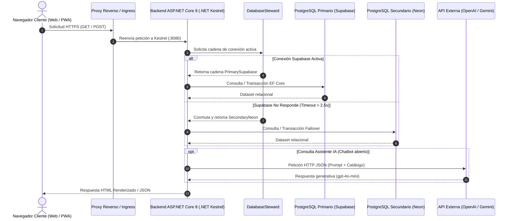
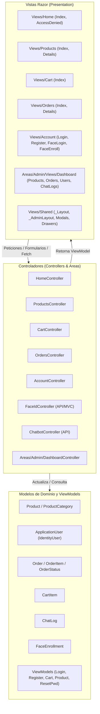
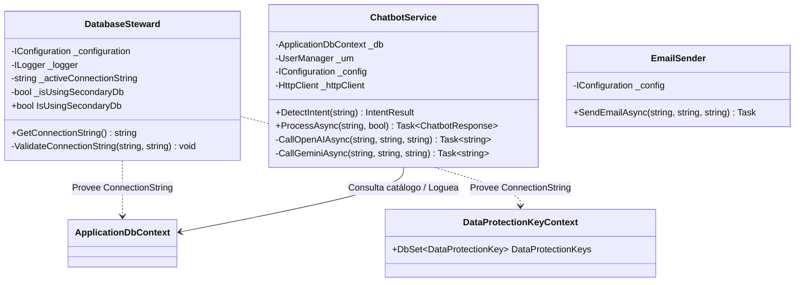

# PROPUESTA TÉCNICA DE SERVICIOS TI Y ARQUITECTURA DE SOFTWARE
## PLATAFORMA DE COMERCIO ELECTRÓNICO DYPSTORE

---

### Control del Documento
- **Proyecto:** DYPStore — Tienda Deportiva de Alto Rendimiento
- **Código Documental:** TI-PROP-2026-01
- **Versión:** 1.0 (Entrega Académica Oficial)
- **Fecha:** Noviembre 2026
- **Elaborado por:** Especialista en Arquitectura de Software y Soluciones TI
- **Estado:** Verificado contra Código Fuente y Despliegue

---

## 1. INTRODUCCIÓN

En la era del comercio digital moderno, las plataformas de retail deportivo exigen arquitecturas de Tecnologías de la Información (TI) altamente disponibles, seguras, escalables y dotadas de capacidades diferenciadoras basadas en inteligencia artificial y tecnologías biométricas. 

El proyecto **DYPStore** representa una solución integral de software empresarial que trasciende los paradigmas tradicionales de e-commerce. Construida sobre el ecosistema **.NET 8 (LTS)** y el motor de base de datos relacional **PostgreSQL**, la plataforma integra servicios distribuidos en la nube, conmutación automática por error (*failover* multi-proveedor entre Supabase y Neon), biometría facial en el navegador mediante redes convolucionales y asistencia conversacional inteligente con modelos fundacionales (OpenAI GPT-4o-mini y Google Gemini).

El presente documento expone la propuesta técnica formal, describiendo la topología arquitectónica de capas, los servicios de TI involucrados, las políticas de seguridad, las directrices de despliegue en contenedores Docker y la estrategia de mantenimiento y escalabilidad para garantizar la continuidad operativa de la plataforma.

---

## 2. OBJETIVOS DE LA PROPUESTA TÉCNICA

### 2.1 Objetivo General
Diseñar, fundamentar y formalizar la arquitectura de servicios de TI de la plataforma DYPStore, asegurando una infraestructura tecnológica tolerante a fallos, protegida bajo estándares internacionales de ciberseguridad y capaz de ofrecer una experiencia de usuario interactiva y fluida.

### 2.2 Objetivos Específicos
1. Formalizar la arquitectura multicapa basada en el patrón Modelo-Vista-Controlador (MVC) y la separación de responsabilidades en .NET 8.
2. Detallar el diseño de la capa de persistencia en PostgreSQL con resiliencia de conexión y conmutación automática mediante el servicio singleton `DatabaseSteward`.
3. Especificar la arquitectura de autenticación híbrida que combina el marco de trabajo ASP.NET Core Identity, autenticación federada OAuth (Google vía Supabase) y reconocimiento biométrico facial 128D.
4. Describir los servicios tecnológicos internos y las integraciones con APIs externas de inteligencia artificial (OpenAI y Gemini).
5. Definir la infraestructura de despliegue basada en contenedores Docker multi-etapa y plataformas en la nube (Azure App Service / Render).
6. Delimitar estrictamente los componentes actualmente implementados y en producción de aquellas funcionalidades preparadas o proyectadas para etapas futuras.

---

## 3. ALCANCE DE LOS SERVICIOS TI

La infraestructura tecnológica de DYPStore abarca los siguientes componentes y subsistemas:
- **Capa de Frontend e Interacción:** Vistas Razor semánticas, estilos responsivos en CSS3/Bootstrap 5.3, manipulación DOM asíncrona, PWA con Service Worker, Web Speech API y motor de inferencia neuronal *face-api.js*.
- **Capa de Lógica de Negocio y Aplicación:** ASP.NET Core 8 Web API y MVC, inyección de dependencias, validaciones automáticas con FluentValidation, limitadores de tasa (*Rate Limiting*) y gestión de sesiones protegidas.
- **Capa de Persistencia y Datos:** Entity Framework Core 8, proveedor Npgsql PostgreSQL, migraciones de esquema versionadas y persistencia centralizada de claves criptográficas (*Data Protection Keys*).
- **Capa de Resiliencia de Infraestructura:** Mecanismo activo de failover de base de datos con detección de fallos por timeout (<2.5s) entre dos proveedores cloud independientes (Supabase como primario y Neon como secundario).
- **Servicios de Despliegue:** Contenedorización Docker optimizada para arquitecturas Linux x64/ARM, scripts de automatización CLI y archivos de manifiesto para PaaS (*Platform as a Service*).

---

## 4. ARQUITECTURA CLIENTE-SERVIDOR

El sistema adopta una arquitectura cliente-servidor distribuida sobre el protocolo de transporte seguro **HTTPS (TLS 1.3)**. El cliente ejecuta la interfaz de usuario en el navegador web del usuario final (Mobile o Desktop), realizando peticiones sincronizadas de renderizado HTML y llamadas asíncronas vía API REST (JSON) para funcionalidades especializadas como Face ID y Chatbot.

### Características de la Comunicación:
- **Protocolo de Transporte:** HTTPS con redirección obligatoria (`app.UseHttpsRedirection()`) y política de seguridad HSTS (*HTTP Strict Transport Security*) activa en entornos de producción.
- **Resolución de Red Robusta:** Forzado de pila IPv4 mediante `AppContext.SetSwitch("System.Net.Http.UseSocketsHttpHandler", true)` y `ServicePointManager.DnsRefreshTimeout = 0` en `Program.cs` para mitigar latencias de resolución DNS en entornos de red híbridos.
- **Manejo de Errores Desacoplado:** Middleware global de captura de excepciones (`app.UseExceptionHandler("/Home/Error")`) que impide la divulgación de trazas de pila (*stack traces*) al usuario final.

---

## 5. ARQUITECTURA MVC (MODELO - VISTA - CONTROLADOR)

La solución está implementada sobre el patrón arquitectónico MVC nativo de ASP.NET Core, subdividido modularmente para garantizar el principio de responsabilidad única (*Single Responsibility Principle*):

---

## 6. CAPAS DE LA SOLUCIÓN TECNOLÓGICA

### 6.1 Capa de Presentación
La capa visual está construida sobre el motor de renderizado de vistas de **Razor (.cshtml)**, complementada con un diseño moderno de temática oscura deportiva:
- **Framework UI:** Bootstrap 5.3.3 y Bootstrap Icons 1.11.3 provistos vía CDN de alta velocidad.
- **Sistema de Diseño (Design System):** Variables nativas CSS en `wwwroot/css/site.css` (`--dyp-red: #ff2d4d`, `--dyp-black: #07070a`, `--dyp-surface: #121217`, `--dyp-border: rgba(255,255,255,0.08)`), complementado con tipografías deportivas de impacto (`Barlow Condensed` para titulares e `Inter` para cuerpos de texto).
- **Componentes UX Innovadores:**
  - *Pantalla de Introducción Animada:* Canvas de rayos luminosos renderizado con aceleración por hardware (Web Audio API para sonido de arranque TA-DUM).
  - *Drawer Lateral de Wishlist y Comparador:* Paneles deslizables no bloqueantes sin recarga.
  - *Modal de Vista Rápida (Quick View):* Consulta asíncrona de producto.
  - *Búsqueda por Voz:* Integración nativa con la API de reconocimiento de voz del navegador (`webkitSpeechRecognition` / `SpeechRecognition`).
- **Inferencia Biométrica en Cliente:** Biblioteca *face-api.js* ejecutando modelos neuronales comprimidos (`TinyFaceDetector` para detección y `FaceRecognitionNet` para generación de embeddings de 128 dimensiones).
- **Progressive Web App (PWA):** Manifiesto web oficial (`manifest.json`) e implementación de Service Worker (`sw.js`) con estrategia de caché *stale-while-revalidate* para recursos estáticos.

### 6.2 Capa de Aplicación
Contiene la orquestación de la lógica de negocio, validaciones y políticas de seguridad:
- **Controladores Tipados:** Procesamiento estructurado de acciones de usuario y despacho de vistas.
- **Validación Automática de Modelos:** Integración con **FluentValidation** (`RegisterViewModelValidator`, `LoginViewModelValidator`) acoplado al pipeline de MVC mediante `builder.Services.AddFluentValidationAutoValidation()`.
- **Protección contra Fuerza Bruta (Rate Limiting):** Configuración de un limitador de ventana fija en `Program.cs` (`options.AddFixedWindowLimiter("faceid", ...)`) que restringe a 10 peticiones por minuto con código de estado HTTP 429 para proteger endpoints de biometría.
- **Middleware de Inyección de Estado:** Inyección del indicador de base de datos activa (`context.Items["IsSecondaryDb"] = steward.IsUsingSecondaryDb`) para alertar al frontend en caso de operación sobre el nodo de respaldo.

### 6.3 Capa de Persistencia
- **Entity Framework Core 8 (EF Core):** Mapeador objeto-relacional (ORM) configurado para PostgreSQL a través de **Npgsql.EntityFrameworkCore.PostgreSQL**.
- **Modelado Fluente (Fluent API):** Configuración exhaustiva en `ApplicationDbContext.cs` estableciendo claves foráneas, índices únicos, conversiones de enums a strings y restricciones *CHECK* a nivel de base de datos.
- **Persistencia Criptográfica Compartida:** Implementación de `DataProtectionKeyContext` que almacena las claves maestras de cifrado de cookies y tokens en la tabla `DataProtectionKeys`, garantizando la persistencia entre reinicios de la aplicación y escalado horizontal.
- **Control de Transacciones e Inventario:** Operaciones de Checkout atómicas con verificación previa de existencias y deducción de stock en la misma unidad de trabajo.

### 6.4 Base de Datos
- **Motor:** PostgreSQL versión 15/16 en arquitectura Cloud.
- **Topología de Alta Disponibilidad:**
  - *Primaria:* PostgreSQL alojado en **Supabase** (us-east-1).
  - *Secundaria (Failover):* PostgreSQL alojado en **Neon Serverless Database** (aws-us-east-1).
- **Garantías ACID:** Aislamiento transaccional estricto, claves primarias numéricas autoincrementales (`IDENTITY`) y llaves alfanuméricas UUID/Text para cuentas de usuario.

---

## 7. SERVICIOS TECNOLÓGICOS IMPLEMENTADOS

### 7.1 DatabaseSteward (`DYPStore/services/DatabaseSteward.cs`)
Servicio registrado como **Singleton** en el contenedor de inyección de dependencias. Gestiona la resiliencia de la conexión a la base de datos:
1. Lee las cadenas `PrimarySupabase` y `SecondaryNeon` desde la configuración.
2. Intenta abrir una conexión de prueba hacia Supabase.
3. Si la conexión primaria falla (por error de credencial, timeout de red o caída del servicio), captura la excepción, registra la alerta en los logs y valida la cadena secundaria.
4. Conecta exitosamente a Neon y marca la bandera `IsUsingSecondaryDb = true`.
5. Retorna la cadena activa para ser inyectada en los contextos de EF Core.

### 7.2 ChatbotService (`DYPStore/services/ChatbotService.cs`)
Servicio registrado como **Scoped** que ofrece un motor híbrido de asistencia conversacional:
- **Motor de Clasificación por Reglas (Rule Scoring):** Evalúa palabras clave ponderadas para clasificar 23 intenciones diferentes (saludos, búsqueda de productos, consultas de stock, precios, recomendaciones y preguntas frecuentes).
- **Procesamiento de Comandos Administrativos:** Permite a usuarios con rol `Admin` consultar productos con bajo stock, existencias agotadas o modificar precios y unidades directamente mediante lenguaje natural.
- **Enlace con Modelos Generativos (Fallback):** En caso de consultas complejas o preguntas abiertas, el servicio consume la API de **OpenAI (GPT-4o-mini)** o **Google Gemini**, transmitiendo un *system prompt* detallado que incluye el catálogo de productos disponible en tiempo real.

### 7.3 EmailSender (`DYPStore/services/EmailSender.cs`)
Servicio registrado como **Transient** que implementa la interfaz `IEmailSender`:
- Se comunica con servidores SMTP (por defecto `smtp.gmail.com` en puerto 587 con cifrado TLS).
- Despacha correos electrónicos transaccionales con diseño HTML responsivo oscuro para la recuperación de contraseñas.
- Incorpora un modo de simulación en consola para entornos de desarrollo local en caso de ausencia de credenciales SMTP configuradas.

---

## 8. SERVICIOS EXTERNOS E INTEGRACIONES

| Servicio Externo | Proveedor | Protocolo / SDK | Estado en el Proyecto | Propósito |
| :--- | :--- | :--- | :--- | :--- |
| **PostgreSQL Primario** | Supabase | Npgsql Wire Protocol (TCP 5432 / 6543) | **Implementado** | Almacenamiento principal de datos relacionales, Identity y catálogo. |
| **PostgreSQL Backup** | Neon Database | Npgsql Wire Protocol (TCP 5432) | **Implementado** | Nodo secundario para failover de alta disponibilidad. |
| **Autenticación Google** | Supabase Auth | HTTPS / REST / JWT | **Implementado** | Inicio de sesión con cuentas de Google sincronizado a Identity local. |
| **IA Conversacional** | OpenAI API | HTTPS REST (POST v1/chat/completions) | **Implementado** | Generación de respuestas para el chatbot (modelo gpt-4o-mini). |
| **IA Alternativa** | Google Gemini API | HTTPS REST | **Implementado** | Proveedor secundario de lenguaje natural configurado en ChatbotService. |
| **CDN de Imágenes** | Unsplash CDN | HTTPS | **Implementado** | Alojamiento y optimización de imágenes de alta definición del catálogo. |
| **Envío de Correos** | Google SMTP | SMTP / TLS (Puerto 587) | **Implementado** | Despacho de correos de restablecimiento de contraseña. |
| **Pasarela de Pagos** | Stripe / Wompi | Webhook / API REST | *Preparado / Propuesto* | Diseñado en la arquitectura para procesar cobros con tarjeta en checkout. |
| **Notificaciones Push** | Firebase Cloud Messaging | Web Push Protocol | *Preparado / Propuesto* | Estructura definida en Service Worker (`sw.js`) para avisos de pedidos. |
| **Sistema de Reseñas** | DYP Community | API Interna | *Preparado / Propuesto* | Modelo conceptual para valoraciones y comentarios de clientes. |

---

## 9. INFRAESTRUCTURA Y ESTRATEGIA DE DESPLIEGUE

### 9.1 Contenedorización con Docker
El proyecto cuenta con un `Dockerfile` multi-etapa (*multi-stage build*) basado en imágenes oficiales de Microsoft en Linux:
1. **Etapa 1 (Build):** Utiliza `mcr.microsoft.com/dotnet/sdk:8.0`. Restaura dependencias NuGet y compila en modo `Release`.
2. **Etapa 2 (Publish):** Genera los binarios empaquetados optimizados.
3. **Etapa 3 (Runtime):** Utiliza `mcr.microsoft.com/dotnet/aspnet:8.0` como imagen ligera de producción. Expone el puerto `8080`, configura `ASPNETCORE_URLS=http://+:8080` y define el punto de entrada ejecutable `dotnet DYPStore.dll`.

### 9.2 Plataformas de Despliegue Cloud Soportadas
1. **Render PaaS:** Configurado mediante el archivo `render.yaml`, automatizando la compilación de la rama `main`, la asignación de variables de entorno de producción y el sondeo de salud (*health check*) en la ruta raíz `/`.
2. **Azure App Service (Linux):** Automatizado mediante el script de PowerShell `azure-config.ps1`, el cual aprovisiona y configura las cadenas de conexión y parámetros de configuración mediante comandos de la CLI de Azure (`az webapp config appsettings set`).

---

## 10. SEGURIDAD DE LA INFORMACIÓN Y CUMPLIMIENTO

La plataforma adopta medidas preventivas para mitigar las vulnerabilidades más críticas definidas en el estándar **OWASP Top 10**:

1. **Inyección de Código (SQLi):** Mitigada al 100% mediante el uso exclusivo de consultas parametrizadas generadas por el ORM Entity Framework Core.
2. **Falsificación de Solicitud en Sitios Cruzados (CSRF):** Aplicación rigurosa del atributo `[ValidateAntiForgeryToken]` en todos los métodos POST del sistema y renderizado de tokens en las vistas Razor.
3. **Autenticación Rota y Fuerza Bruta:** 
   - Hashing robusto de contraseñas mediante PBKDF2 con sal individualizada (estándar ASP.NET Identity).
   - Bloqueo de cuenta (*Account Lockout*) por 5 minutos ante 5 intentos fallidos consecutivos.
   - Limitador de tasa (*Rate Limiting*) en la verificación biométrica facial para prevenir ataques de suplantación automatizada.
4. **Privacidad de Biometría:** La solución no captura, transmite ni almacena imágenes fotográficas de rostros. El cálculo del vector descriptor de 128 flotantes se efectúa estrictamente en el navegador cliente mediante modelos de aprendizaje profundo en JavaScript. El servidor únicamente recibe y almacena el vector matemático numérico, haciendo imposible reconstruir la fotografía original del usuario a partir de los datos almacenados.
5. **Cifrado de Sesiones y Cookies:** Cookies de autenticación marcadas como `HttpOnly`, `Secure` y con política `SameSite=Lax` para mitigar ataques XSS y secuestro de sesión.

---

## 11. REQUERIMIENTOS TÉCNICOS DEL SISTEMA

### 11.1 Servidor de Aplicaciones (Entorno de Producción)
- **Sistema Operativo:** Linux (Ubuntu Server 22.04 LTS / Alpine) o Windows Server 2022.
- **Motor de Ejecución:** .NET Runtime 8.0 o contenedor Docker.
- **Procesador (CPU):** 2 núcleos virtuales (vCPU) mínimo; 4 vCPU recomendado.
- **Memoria RAM:** 2 GB mínimo; 4 GB recomendado para absorber picos de tráfico concurrente.
- **Almacenamiento:** 10 GB de disco SSD para logs y binarios del sistema.
- **Red:** Interfaz de 100 Mbps o superior con conectividad saliente a puertos 443 (APIs externas/HTTPS), 5432/6543 (PostgreSQL) y 587 (SMTP).

### 11.2 Servidor de Base de Datos
- **Motor:** PostgreSQL versión 15 o 16.
- **Almacenamiento de Datos:** Mínimo 1 GB escalable automáticamente según volumen transaccional.
- **Conexiones Concurrentes:** Grupo de conexiones (*connection pool*) de al menos 20 a 50 conexiones simultáneas.

### 11.3 Estación de Usuario Final (Cliente)
- **Navegadores Soportados:** Google Chrome (versión 100+), Mozilla Firefox (versión 100+), Microsoft Edge (versión 100+), Apple Safari (versión 15+).
- **Periféricos (Opcional para Biometría / Voz):** Cámara web con resolución mínima VGA (640x480) y micrófono para dictado de búsqueda.
- **Conectividad:** Conexión a internet estable (3G, 4G, 5G o banda ancha).

---

## 12. JUSTIFICACIÓN DE DECISIONES TECNOLÓGICAS

| Tecnología | Rol en la Solución | Justificación Técnica |
| :--- | :--- | :--- |
| **ASP.NET Core 8.0** | Framework Backend | Ofrece uno de los rendimientos más veloces de la industria en benchmarks TechEmpower, soporte a largo plazo (LTS), tipado estático seguro con C#, arquitectura nativa de inyección de dependencias y modularidad para despliegue en microservicios o monolitos modulares. |
| **Entity Framework Core 8** | ORM de Persistencia | Facilita el mantenimiento del esquema mediante migraciones versionadas en C#, previene inyecciones SQL por defecto y permite definir restricciones CHECK complejas de base de datos desde código. |
| **PostgreSQL (Npgsql)** | Base de Datos | Motor relacional open-source de grado empresarial con soporte avanzado para tipos JSON, transacciones ACID rigurosas, índices B-Tree optimizados y amplia disponibilidad en proveedores cloud modernos (Supabase, Neon). |
| **Supabase + Neon (Failover)** | Infraestructura de BD | Garantiza alta disponibilidad sin incurrir en costos de clústeres empresariales redundantes, asegurando tolerancia a desastres mediante conmutación automática controlada por software. |
| **face-api.js** | Inferencia Biométrica | Permite ejecutar modelos de visión por computador directamente en el navegador del cliente mediante WebGL/TensorFlow.js, garantizando privacidad absoluta (las fotos nunca viajan por la red) y reduciendo la carga de cómputo en el servidor. |
| **OpenAI GPT-4o-mini** | Motor de IA Conversacional | Provee razonamiento contextual en lenguaje natural a un costo de inferencia extremadamente eficiente y baja latencia, integrando el catálogo de la tienda para generar respuestas hiperpersonalizadas. |
| **Docker** | Contenedorización | Garantiza reproducibilidad exacta del entorno de ejecución ("build once, run anywhere"), facilitando el despliegue inmediato en cualquier plataforma en la nube compatible con contenedores. |

---

## 13. MANTENIMIENTO, SOPORTE Y MONITOREO

### 13.1 Estrategia de Copias de Seguridad (Backups)
- **Backups Automatizados en Cloud:** Supabase y Neon efectúan copias de seguridad continuas a nivel de WAL (*Write-Ahead Logging*) con retención de 7 días.
- **Exportación Periódica de Esquema:** Generación programada de volcados lógicos mediante `pg_dump` para salvaguardar la integridad de las tablas de pedidos y usuarios.

### 13.2 Registro de Eventos y Monitoreo (Logging)
- Registro estructurado con `ILogger` integrado en ASP.NET Core.
- Auditoría exhaustiva en la tabla `ChatLogs` para rastrear peticiones anómalas, intenciones no reconocidas y operaciones de escritura ejecutadas desde el asistente conversacional.
- Monitoreo de conmutaciones en `DatabaseSteward`, emitiendo alertas de advertencia (*Warning*) cuando el sistema opera sobre el nodo de contingencia Neon.

### 13.3 Rotación y Ciclo de Vida de Claves
- Las claves criptográficas de ASP.NET Core Data Protection se auto-generan y almacenan en la tabla `DataProtectionKeys`. Se recomienda una política de expiración predeterminada de 90 días con renovación transparente sin desconexión de usuarios concurrentes.

---

## 14. ESTRATEGIA DE ESCALABILIDAD

1. **Escalabilidad Horizontal de la Aplicación:**
   Al mantener la persistencia de las claves de protección de datos (`DataProtectionKeys`) en la base de datos PostgreSQL compartida y manejar sesiones basadas en cookies firmadas criptográficamente, el backend de DYPStore es **100% sin estado (Stateless)**. Múltiples instancias en contenedores Docker pueden colocarse detrás de un balanceador de carga (Nginx, Azure Load Balancer o Cloudflare) sin pérdida de sincronización de sesiones.
2. **Escalabilidad de la Base de Datos:**
   Neon ofrece escalabilidad elástica computacional automática (*Auto-suspend* y *Auto-scale vCPU*). Para cargas masivas de lectura, la arquitectura admite la configuración de réplicas de lectura de PostgreSQL conectadas a los contextos de solo lectura de EF Core.

---

## 15. CONCLUSIONES

La propuesta técnica de servicios TI para **DYPStore** consolida una arquitectura de software de nivel industrial que conjuga:
- **Resiliencia Operativa:** Eliminación del punto único de fallo en la capa de datos gracias a la integración dual de Supabase y Neon administrada por `DatabaseSteward`.
- **Seguridad Rigurosa:** Protección de extremo a extremo que abarca desde el cifrado de datos y restricciones de integridad en base de datos hasta la privacidad ética en el tratamiento de biometría facial.
- **Modernidad Tecnológica:** Adopción de .NET 8 LTS, PostgreSQL, contenedores Docker y servicios inteligentes que posicionan a DYPStore como una plataforma de comercio electrónico de vanguardia, preparada tanto para la evaluación académica rigurosa como para su operación en entornos reales de producción.

