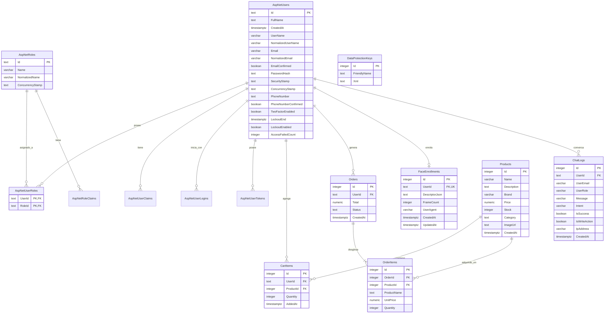

# MODELO Y ESPECIFICACIÓN DE BASE DE DATOS
## PLATAFORMA DE COMERCIO ELECTRÓNICO DYPSTORE

---

### Control del Documento
- **Proyecto:** DYPStore
- **Código Documental:** BD-DOC-2026-01
- **Versión:** 1.0 (Entrega Académica Oficial)
- **Motor de Base de Datos:** PostgreSQL 15 / 16 (Npgsql EF Core Provider)
- **Fuentes de Verificación:** `ApplicationDbContext.cs`, Modelos en `Models/`, Migraciones en `Migrations/` y `ApplicationDbContextModelSnapshot.cs`
- **Estado:** Verificado y Auditado contra Esquema Real

---

## 1. INTRODUCCIÓN

El almacenamiento y la persistencia de datos en la plataforma **DYPStore** están soportados sobre un diseño relacional altamente normalizado, tipificado para el motor de base de datos relacional de código abierto **PostgreSQL**. La estructura combina la arquitectura de seguridad y gestión de usuarios provista por **ASP.NET Core Identity** con entidades propias del dominio de negocio deportivo (Catálogo, Carrito de Compras, Órdenes Transaccionales, Biometría Facial, Historial de Asistencia de IA y Protección de Claves de Cifrado).

El presente documento constituye la especificación formal del modelo de datos de DYPStore. Se definen las entidades, atributos, tipos nativos de PostgreSQL, claves primarias y foráneas, cardinalidades, restricciones de integridad (*CHECK*, *UNIQUE*, *FOREIGN KEY*), índices para la optimización de consultas, un análisis riguroso de normalización hasta Tercera Forma Normal (3FN) y la formalización de dependencias funcionales.

*(Nota: De conformidad con los lineamientos del proyecto, no se incluyen los cinco diagramas UML de análisis y diseño del software, dado que están siendo elaborados por separado en otro entregable).*

---

## 2. MODELO ENTIDAD - RELACIÓN (MER)

A continuación se presenta el diagrama Entidad-Relación relacional de la base de datos de DYPStore, visualizando las entidades del sistema y sus relaciones cardinales.

---

## 3. DICCIONARIO DE DATOS Y ESPECIFICACIÓN DE ENTIDADES

### 3.1 Entidades Propias del Dominio DYPStore

#### 3.1.1 Tabla: `Products` (Catálogo de Artículos Deportivos)
Almacena el catálogo de equipamiento deportivo clasificado en tres disciplinas (`boxing`, `shoes`, `supplements`).

| Columna | Tipo PostgreSQL | Nulo | Clave | Valor por Defecto | Descripción |
| :--- | :--- | :--- | :--- | :--- | :--- |
| `Id` | `integer` | No | PK | `IDENTITY` | Identificador único secuencial del producto. |
| `Name` | `character varying(200)` | No | - | - | Nombre comercial del artículo deportivo. |
| `Description` | `text` | No | - | - | Descripción detallada de especificaciones y materiales. |
| `Brand` | `character varying(100)` | No | - | - | Marca fabricante (Everlast, Nike, Venum, etc.). |
| `Price` | `numeric(18,2)` | No | - | - | Precio unitario de venta. |
| `Stock` | `integer` | No | - | `0` | Existencias físicas en inventario. |
| `Category` | `text` | No | - | - | Disciplina: `'boxing'`, `'shoes'`, `'supplements'`. |
| `ImageUrl` | `text` | Sí | - | `NULL` | Enlace URL a la imagen optimizada (CDN). |
| `CreatedAt` | `timestamp with time zone` | No | - | `CURRENT_TIMESTAMP` | Fecha y hora UTC de alta del producto. |

- **Restricciones CHECK:**
  - `CK_Product_Stock_Positive`: `"Stock" >= 0`
  - `CK_Product_Price_Positive`: `"Price" >= 0`

---

#### 3.1.2 Tabla: `CartItems` (Ítems en Carrito de Compras)
Registra los productos añadidos al carrito por usuarios autenticados antes de consolidar la compra.

| Columna | Tipo PostgreSQL | Nulo | Clave | Valor por Defecto | Descripción |
| :--- | :--- | :--- | :--- | :--- | :--- |
| `Id` | `integer` | No | PK | `IDENTITY` | Identificador único del registro de carrito. |
| `UserId` | `text` | No | FK | - | Referencia al usuario propietario (`AspNetUsers.Id`). |
| `ProductId` | `integer` | No | FK | - | Referencia al producto seleccionado (`Products.Id`). |
| `Quantity` | `integer` | No | - | `1` | Cantidad solicitada por el cliente. |
| `AddedAt` | `timestamp with time zone` | No | - | `CURRENT_TIMESTAMP` | Fecha y hora de adición al carrito. |

- **Restricción CHECK:**
  - `CK_CartItem_Quantity_Positive`: `"Quantity" > 0`
- **Reglas de Integridad Referencial:**
  - `FK_CartItems_AspNetUsers_UserId`: ON DELETE CASCADE.
  - `FK_CartItems_Products_ProductId`: ON DELETE CASCADE.

---

#### 3.1.3 Tabla: `Orders` (Órdenes de Compra / Cabecera de Pedido)
Almacena la cabecera transaccional de los pedidos generados por los clientes tras el checkout.

| Columna | Tipo PostgreSQL | Nulo | Clave | Valor por Defecto | Descripción |
| :--- | :--- | :--- | :--- | :--- | :--- |
| `Id` | `integer` | No | PK | `IDENTITY` | Identificador numérico del pedido (`#000001`). |
| `UserId` | `text` | No | FK | - | Referencia al cliente que generó la orden (`AspNetUsers.Id`). |
| `Total` | `numeric(18,2)` | No | - | `0.00` | Monto total liquidado del pedido. |
| `Status` | `text` | No | - | `'pending'` | Estado del pedido: `'pending'`, `'processing'`, `'completed'`, `'cancelled'`. |
| `CreatedAt` | `timestamp with time zone` | No | - | `CURRENT_TIMESTAMP` | Fecha y hora UTC de generación del pedido. |

- **Restricción CHECK:**
  - `CK_Order_Total_Positive`: `"Total" >= 0`
- **Regla de Integridad Referencial:**
  - `FK_Orders_AspNetUsers_UserId`: ON DELETE RESTRICT (impide eliminar usuarios con historial de pedidos).

---

#### 3.1.4 Tabla: `OrderItems` (Detalle de Líneas de Pedido)
Almacena el desglose de productos, cantidades y precios históricos asociados a una orden.

| Columna | Tipo PostgreSQL | Nulo | Clave | Valor por Defecto | Descripción |
| :--- | :--- | :--- | :--- | :--- | :--- |
| `Id` | `integer` | No | PK | `IDENTITY` | Identificador único de la línea de pedido. |
| `OrderId` | `integer` | No | FK | - | Referencia al pedido cabecera (`Orders.Id`). |
| `ProductId` | `integer` | No | FK | - | Referencia al producto adquirido (`Products.Id`). |
| `ProductName` | `text` | No | - | - | Nombre del producto al momento de la compra (inmutable). |
| `UnitPrice` | `numeric(18,2)` | No | - | - | Precio unitario congelado al momento de la orden. |
| `Quantity` | `integer` | No | - | - | Unidades compradas. |

- **Restricciones CHECK:**
  - `CK_OrderItem_Quantity_Positive`: `"Quantity" > 0`
  - `CK_OrderItem_UnitPrice_Positive`: `"UnitPrice" >= 0`
- **Reglas de Integridad Referencial:**
  - `FK_OrderItems_Orders_OrderId`: ON DELETE CASCADE.
  - `FK_OrderItems_Products_ProductId`: ON DELETE CASCADE (ajustado en migración `FixContext`).

---

#### 3.1.5 Tabla: `FaceEnrollments` (Perfiles Biométricos Face ID)
Almacena los descriptores biométricos generados en el cliente para el reconocimiento facial.

| Columna | Tipo PostgreSQL | Nulo | Clave | Valor por Defecto | Descripción |
| :--- | :--- | :--- | :--- | :--- | :--- |
| `Id` | `integer` | No | PK | `IDENTITY` | Identificador único del perfil biométrico. |
| `UserId` | `text` | No | FK, UK | - | Usuario asociado (`AspNetUsers.Id`). Único por usuario. |
| `DescriptorJson` | `text` | No | - | - | Arreglo JSON de 128 valores en punto flotante (vector biométrico). |
| `FrameCount` | `integer` | No | - | `1` | Número de fotogramas promediados (calidad de registro). |
| `UserAgent` | `character varying(300)` | Sí | - | `NULL` | Navegador y dispositivo utilizado durante el enrolamiento. |
| `CreatedAt` | `timestamp with time zone` | No | - | `CURRENT_TIMESTAMP` | Fecha de creación del registro biométrico. |
| `UpdatedAt` | `timestamp with time zone` | No | - | `CURRENT_TIMESTAMP` | Fecha de última actualización del vector. |

- **Regla de Integridad Referencial:**
  - `FK_FaceEnrollments_AspNetUsers_UserId`: ON DELETE CASCADE.
- **Índice Único:**
  - `IX_FaceEnrollments_UserId`: Garantiza cardinalidad 1 a 1 entre usuario y registro biométrico.

---

#### 3.1.6 Tabla: `ChatLogs` (Auditoría de Conversaciones del Asistente IA)
Registra las consultas, intenciones y comandos procesados por el asistente virtual.

| Columna | Tipo PostgreSQL | Nulo | Clave | Valor por Defecto | Descripción |
| :--- | :--- | :--- | :--- | :--- | :--- |
| `Id` | `integer` | No | PK | `IDENTITY` | Identificador único del registro de auditoría. |
| `UserId` | `text` | Sí | FK | `NULL` | Identificador de usuario o NULL si es anónimo. |
| `UserEmail` | `character varying(256)` | No | - | `''` | Correo del usuario o 'Anónimo'. |
| `UserRole` | `character varying(20)` | No | - | `'User'` | Rol del emisor: `'Admin'`, `'User'`, `'Anonymous'`. |
| `Message` | `character varying(500)` | No | - | - | Texto de la consulta del usuario. |
| `Intent` | `character varying(60)` | No | - | `''` | Intención clasificada (`Greeting`, `CheckPrice`, etc.). |
| `IsSuccess` | `boolean` | No | - | `true` | Indicador de resolución satisfactoria. |
| `IsWriteAction` | `boolean` | No | - | `false` | Indica si ejecutó modificación (precio/stock). |
| `IpAddress` | `character varying(60)` | Sí | - | `NULL` | Dirección IP cliente para auditoría de seguridad. |
| `CreatedAt` | `timestamp with time zone` | No | - | `CURRENT_TIMESTAMP` | Fecha y hora UTC del mensaje. |

- **Regla de Integridad Referencial:**
  - `FK_ChatLogs_AspNetUsers_UserId`: ON DELETE SET NULL (preserva la auditoría histórica si el usuario se elimina).

---

#### 3.1.7 Tabla: `DataProtectionKeys` (Claves Maestras de Cifrado)
Gestionada por `DataProtectionKeyContext` para la persistencia centralizada de llaves de cifrado de cookies y tokens de sesión.

| Columna | Tipo PostgreSQL | Nulo | Clave | Valor por Defecto | Descripción |
| :--- | :--- | :--- | :--- | :--- | :--- |
| `Id` | `integer` | No | PK | `IDENTITY` | Identificador numérico de la clave de protección. |
| `FriendlyName` | `text` | Sí | - | `NULL` | Nombre descriptivo o identificador de la clave. |
| `Xml` | `text` | No | - | - | Carga útil cifrada en formato XML que contiene la llave de cifrado. |

---

### 3.2 Entidades del Subsistema ASP.NET Core Identity

#### 3.2.1 Tabla: `AspNetUsers` (Cuentas de Usuario)
Extensión de `IdentityUser` que incorpora `FullName` y `CreatedAt`.

| Columna | Tipo PostgreSQL | Nulo | Clave | Descripción |
| :--- | :--- | :--- | :--- | :--- |
| `Id` | `text` | No | PK | Identificador único alfanumérico (GUID / String). |
| `FullName` | `text` | No | - | Nombre completo del usuario. |
| `CreatedAt` | `timestamp with time zone` | No | - | Fecha de registro de la cuenta. |
| `UserName` | `character varying(256)` | Sí | - | Nombre de usuario (sincronizado con Email). |
| `NormalizedUserName` | `character varying(256)` | Sí | UK | Nombre de usuario normalizado para búsquedas. |
| `Email` | `character varying(256)` | Sí | - | Correo electrónico de la cuenta. |
| `NormalizedEmail` | `character varying(256)` | Sí | IDX | Correo electrónico normalizado. |
| `EmailConfirmed` | `boolean` | No | - | Indica si el correo fue verificado. |
| `PasswordHash` | `text` | Sí | - | Hash criptográfico de la contraseña (PBKDF2). |
| `SecurityStamp` | `text` | Sí | - | Sello de seguridad para invalidación de sesiones. |
| `ConcurrencyStamp` | `text` | Sí | - | Token de concurrencia optimista. |
| `PhoneNumber` | `text` | Sí | - | Número telefónico de contacto. |
| `PhoneNumberConfirmed` | `boolean` | No | - | Verificación telefónica. |
| `TwoFactorEnabled` | `boolean` | No | - | Estado de autenticación en dos pasos. |
| `LockoutEnd` | `timestamp with time zone` | Sí | - | Fecha de finalización del bloqueo temporal. |
| `LockoutEnabled` | `boolean` | No | - | Habilitación de bloqueo por intentos fallidos. |
| `AccessFailedCount` | `integer` | No | - | Contador de intentos de acceso fallidos. |

#### 3.2.2 Tabla: `AspNetRoles` (Roles de Autorización)
Define los roles del sistema (`Admin`, `User`).

| Columna | Tipo PostgreSQL | Nulo | Clave | Descripción |
| :--- | :--- | :--- | :--- | :--- |
| `Id` | `text` | No | PK | Identificador único del rol. |
| `Name` | `character varying(256)` | Sí | - | Nombre visible del rol (`Admin`, `User`). |
| `NormalizedName` | `character varying(256)` | Sí | UK | Nombre normalizado en mayúsculas (`ADMIN`, `USER`). |
| `ConcurrencyStamp` | `text` | Sí | - | Token de concurrencia del rol. |

#### 3.2.3 Tabla: `AspNetUserRoles` (Asociación Usuario - Rol)
Tabla intermedia de relación muchos a muchos ($M:N$) entre usuarios y roles.

| Columna | Tipo PostgreSQL | Nulo | Clave | Regla Referencial |
| :--- | :--- | :--- | :--- | :--- |
| `UserId` | `text` | No | PK, FK | `FK_AspNetUserRoles_AspNetUsers_UserId` (ON DELETE CASCADE) |
| `RoleId` | `text` | No | PK, FK | `FK_AspNetUserRoles_AspNetRoles_RoleId` (ON DELETE CASCADE) |

#### 3.2.4 Tablas Complementarias de Identity
- `AspNetUserClaims` (`Id` PK IDENTITY, `UserId` FK, `ClaimType` text, `ClaimValue` text): Declaraciones individuales asociadas al usuario.
- `AspNetRoleClaims` (`Id` PK IDENTITY, `RoleId` FK, `ClaimType` text, `ClaimValue` text): Declaraciones asociadas a un rol.
- `AspNetUserLogins` (`LoginProvider` PK, `ProviderKey` PK, `ProviderDisplayName` text, `UserId` FK): Mapeo de proveedores de inicio de sesión externos.
- `AspNetUserTokens` (`UserId` PK, `LoginProvider` PK, `Name` PK, `Value` text): Tokens de seguridad temporales (ej. token de recuperación de contraseña).

---

## 4. MODELO RELACIONAL FORMAL

El esquema relacional formalizado se define mediante la siguiente notación (claves primarias en negrita subrayada, claves foráneas en cursiva):

- **Products** (**<u>Id</u>**, Name, Description, Brand, Price, Stock, Category, ImageUrl, CreatedAt)
- **AspNetUsers** (**<u>Id</u>**, FullName, CreatedAt, UserName, NormalizedUserName, Email, NormalizedEmail, EmailConfirmed, PasswordHash, SecurityStamp, ConcurrencyStamp, PhoneNumber, PhoneNumberConfirmed, TwoFactorEnabled, LockoutEnd, LockoutEnabled, AccessFailedCount)
- **AspNetRoles** (**<u>Id</u>**, Name, NormalizedName, ConcurrencyStamp)
- **AspNetUserRoles** (**<u>*UserId*</u>**, **<u>*RoleId*</u>**)
- **AspNetUserClaims** (**<u>Id</u>**, *UserId*, ClaimType, ClaimValue)
- **AspNetRoleClaims** (**<u>Id</u>**, *RoleId*, ClaimType, ClaimValue)
- **AspNetUserLogins** (**<u>LoginProvider</u>**, **<u>ProviderKey</u>**, ProviderDisplayName, *UserId*)
- **AspNetUserTokens** (**<u>*UserId*</u>**, **<u>LoginProvider</u>**, **<u>Name</u>**, Value)
- **CartItems** (**<u>Id</u>**, *UserId*, *ProductId*, Quantity, AddedAt)
- **Orders** (**<u>Id</u>**, *UserId*, Total, Status, CreatedAt)
- **OrderItems** (**<u>Id</u>**, *OrderId*, *ProductId*, ProductName, UnitPrice, Quantity)
- **FaceEnrollments** (**<u>Id</u>**, *UserId*, DescriptorJson, FrameCount, UserAgent, CreatedAt, UpdatedAt)
- **ChatLogs** (**<u>Id</u>**, *UserId*, UserEmail, UserRole, Message, Intent, IsSuccess, IsWriteAction, IpAddress, CreatedAt)
- **DataProtectionKeys** (**<u>Id</u>**, FriendlyName, Xml)

---

## 5. ÍNDICES DE BASE DE DATOS

Para optimizar el rendimiento y garantizar la unicidad de las claves candidatas, se han implementado los siguientes índices B-Tree en PostgreSQL:

| Nombre del Índice | Tabla | Columnas Indexadas | Tipo de Índice | Justificación Técnica |
| :--- | :--- | :--- | :--- | :--- |
| `UserNameIndex` | `AspNetUsers` | `NormalizedUserName` | Único (UNIQUE) | Acelera la búsqueda de usuarios por username y garantiza que no existan duplicados. |
| `EmailIndex` | `AspNetUsers` | `NormalizedEmail` | No Único (B-Tree) | Acelera el login mediante correo electrónico y la verificación de unicidad. |
| `RoleNameIndex` | `AspNetRoles` | `NormalizedName` | Único (UNIQUE) | Evita la creación de roles con nombres duplicados. |
| `IX_FaceEnrollments_UserId` | `FaceEnrollments` | `UserId` | Único (UNIQUE) | **Crucial:** Garantiza que cada usuario tenga a lo sumo un solo vector biométrico registrado. |
| `IX_CartItems_UserId` | `CartItems` | `UserId` | No Único (B-Tree) | Acelera la carga de los ítems del carrito del usuario activo. |
| `IX_CartItems_ProductId` | `CartItems` | `ProductId` | No Único (B-Tree) | Optimiza comprobaciones de existencia de producto en carritos activos. |
| `IX_Orders_UserId` | `Orders` | `UserId` | No Único (B-Tree) | Acelera la carga de la vista `/Orders` (historial del cliente). |
| `IX_OrderItems_OrderId` | `OrderItems` | `OrderId` | No Único (B-Tree) | Optimiza el JOIN entre cabecera y líneas de pedido en detalle de pedidos. |
| `IX_OrderItems_ProductId` | `OrderItems` | `ProductId` | No Único (B-Tree) | Facilita la auditoría de ventas por producto. |
| `IX_ChatLogs_UserId` | `ChatLogs` | `UserId` | No Único (B-Tree) | Optimiza el filtrado de conversaciones por usuario. |
| `IX_ChatLogs_CreatedAt` | `ChatLogs` | `CreatedAt` | No Único (B-Tree) | Acelera la paginación y ordenamiento cronológico descendente en el panel de auditoría IA. |

---

## 6. ANÁLISIS DE NORMALIZACIÓN

El diseño relacional de DYPStore ha sido sometido a un análisis formal de normalización, satisfaciendo los criterios de **Primera Forma Normal (1FN)**, **Segunda Forma Normal (2FN)** y **Tercera Forma Normal (3FN)**:

### 6.1 Primera Forma Normal (1FN)
*Regla: Todos los atributos contienen valores atómicos indivisibles; no existen grupos repetitivos ni atributos multivaluados.*
- **Cumplimiento en DYPStore:**
  - Cada columna almacena un único valor escalar según su tipo de dato (`numeric`, `integer`, `timestamp`, `varchar`).
  - La tabla `Orders` no almacena listas o arrays de productos comprados en un solo campo; los productos se desglosan en tuplas independientes dentro de la tabla `OrderItems`.
  - El campo `DescriptorJson` en `FaceEnrollments` almacena un vector numérico 128D como un único documento escalar serializado, procesado en bloque por el modelo biométrico sin requerir consultas relacionales a sus elementos internos.
  - La clave primaria está formalmente definida en todas las tablas (`Id` único secuencial o compuesto).

### 6.2 Segunda Forma Normal (2FN)
*Regla: Cumple 1FN y todos los atributos no clave dependen de manera completa de la clave primaria (no existen dependencias parciales respecto a claves compuestas).*
- **Cumplimiento en DYPStore:**
  - Las tablas con clave primaria simple autoincremental (`Products`, `Orders`, `CartItems`, `ChatLogs`, etc.) cumplen automáticamente 2FN por definición matemática.
  - En las tablas con clave primaria compuesta:
    - En `AspNetUserRoles` (`UserId`, `RoleId`), no existen atributos descriptivos no clave; es una tabla puramente asociativa.
    - En `AspNetUserLogins` (`LoginProvider`, `ProviderKey`), el atributo `UserId` y `ProviderDisplayName` dependen de la combinación de ambos campos del proveedor externo.
    - En `OrderItems`, se optó intencionalmente por una clave primaria simple sustituta (`Id` int), de la cual dependen `OrderId`, `ProductId`, `ProductName`, `UnitPrice` y `Quantity`.

### 6.3 Tercera Forma Normal (3FN)
*Regla: Cumple 2FN y no existen dependencias transitivas (ningún atributo no clave depende funcionalmente de otro atributo no clave).*
- **Cumplimiento en DYPStore:**
  - En `CartItems`: El carrito no almacena el precio ni la marca del producto; almacena únicamente `ProductId`. Los datos del producto se obtienen mediante el JOIN con `Products`, eliminando redundancias transitivas.
  - En `Orders`: La cabecera almacena `Total`, el cual es un valor agregado consolidado y sellado en el momento de la transacción comercial.
  - **Desnormalización Controlada en `OrderItems`:**
    Los campos `ProductName` y `UnitPrice` en `OrderItems` son copias históricas de los valores vigentes al momento del checkout. Si bien formalmente provienen de `Product`, en un sistema de comercio electrónico profesional esto **no es una violación indebida de 3FN**, sino una **desnormalización intencional por inmutabilidad contable**: si un administrador edita el precio o nombre de un producto en el catálogo en el futuro, los pedidos facturados en el pasado no deben sufrir alteraciones.

---

## 7. DEPENDENCIAS FUNCIONALES FORMALES

A continuación se formalizan las dependencias funcionales ($X \rightarrow Y$) que gobiernan el modelo de datos de DYPStore:

### 7.1 Dominio de Catálogo y Carrito
1. `Products`:
   $$\text{Id} \rightarrow \{\text{Name}, \text{Description}, \text{Brand}, \text{Price}, \text{Stock}, \text{Category}, \text{ImageUrl}, \text{CreatedAt}\}$$
2. `CartItems`:
   $$\text{Id} \rightarrow \{\text{UserId}, \text{ProductId}, \text{Quantity}, \text{AddedAt}\}$$
   $$\{\text{UserId}, \text{ProductId}\} \rightarrow \text{Quantity} \quad \text{(Lógica de negocio en controlador)}$$

### 7.2 Dominio Transaccional (Pedidos)
1. `Orders`:
   $$\text{Id} \rightarrow \{\text{UserId}, \text{Total}, \text{Status}, \text{CreatedAt}\}$$
2. `OrderItems`:
   $$\text{Id} \rightarrow \{\text{OrderId}, \text{ProductId}, \text{ProductName}, \text{UnitPrice}, \text{Quantity}\}$$

### 7.3 Dominio de Identidad y Biometría
1. `AspNetUsers`:
   $$\text{Id} \rightarrow \{\text{FullName}, \text{CreatedAt}, \text{UserName}, \text{NormalizedUserName}, \text{Email}, \text{NormalizedEmail}, \dots\}$$
   $$\text{NormalizedUserName} \rightarrow \text{Id} \quad \text{(Por unicidad)}$$
   $$\text{NormalizedEmail} \rightarrow \text{Id} \quad \text{(Garantizado por política RequireUniqueEmail)}$$
2. `FaceEnrollments`:
   $$\text{Id} \rightarrow \{\text{UserId}, \text{DescriptorJson}, \text{FrameCount}, \text{UserAgent}, \text{CreatedAt}, \text{UpdatedAt}\}$$
   $$\text{UserId} \rightarrow \text{Id} \quad \text{(Por índice UNIQUE en UserId)}$$
3. `ChatLogs`:
   $$\text{Id} \rightarrow \{\text{UserId}, \text{UserEmail}, \text{UserRole}, \text{Message}, \text{Intent}, \text{IsSuccess}, \text{IsWriteAction}, \text{IpAddress}, \text{CreatedAt}\}$$

---

## 8. INTEGRIDAD REFERENCIAL Y POLÍTICAS DE BORRADO

El modelo aplica tres comportamientos diferenciados de eliminación referencial (*Referential Actions*) adaptados al rol de cada entidad:

1. **Borrado en Cascada (`ON DELETE CASCADE`):**
   - Si se elimina un registro de `Orders`, se eliminan automáticamente todos sus `OrderItems`.
   - Si se elimina un usuario en `AspNetUsers`, se eliminan en cascada sus `CartItems`, su perfil biométrico `FaceEnrollments`, y sus tablas de relación de Identity (`AspNetUserRoles`, `AspNetUserClaims`, etc.).
   - Si se elimina un `Product`, se eliminan en cascada sus referencias en `CartItems` y `OrderItems` (garantizado en migración `FixContext`).
2. **Borrado Restringido (`ON DELETE RESTRICT`):**
   - En la relación `Orders` $\rightarrow$ `AspNetUsers`, la política es **RESTRICT**. El sistema impide la eliminación física de un usuario de la base de datos si dicho usuario tiene órdenes históricas registradas, protegiendo la trazabilidad contable.
3. **Puesta a Nulo (`ON DELETE SET NULL`):**
   - En la relación `ChatLogs` $\rightarrow$ `AspNetUsers`, la política es **SET NULL**. Si una cuenta de usuario es eliminada, el campo `UserId` en los registros de auditoría de IA se actualiza a `NULL`, pero el registro histórico de la conversación, el correo capturado y la dirección IP se conservan intactos para fines forenses.

---

## 9. CONCLUSIONES

El diseño de base de datos de **DYPStore** evidencia un esquema relacional maduro, robusto y alineado con los estándares de la ingeniería de software moderna:
1. **Tipificación Óptima para PostgreSQL:** Uso de marcas temporales con huso horario (`timestamp with time zone`), números de precisión fija (`numeric(18,2)`) para transacciones financieras y tipos de texto variables optimizados.
2. **Defensa en Profundidad (Restricciones CHECK):** Las reglas de negocio críticas (imposibilidad de stock o precios negativos) están garantizadas no solo por la interfaz de usuario y los controladores C#, sino físicamente reforzadas en el motor de base de datos.
3. **Normalización Rigurosa con Desnormalización Estratégica:** Cumplimiento total de 3FN en todas las entidades operativas, manteniendo la inmutabilidad de precios históricos en las líneas de pedido.
4. **Privacidad y Seguridad Biométrica:** Cardinalidad 1:1 estricta mediante índice único para Face ID, almacenando representaciones vectoriales anonimizadas que protegen la privacidad de los usuarios.

